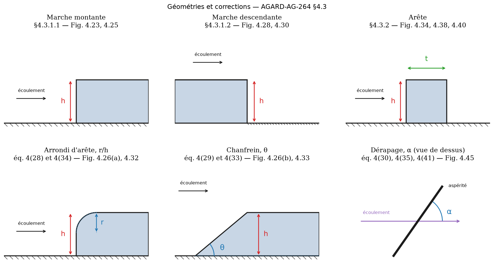
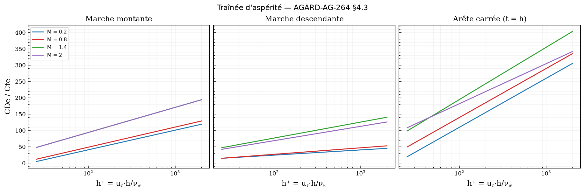
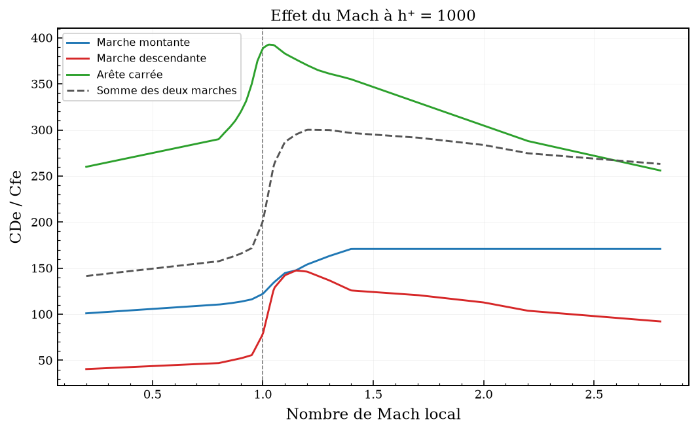
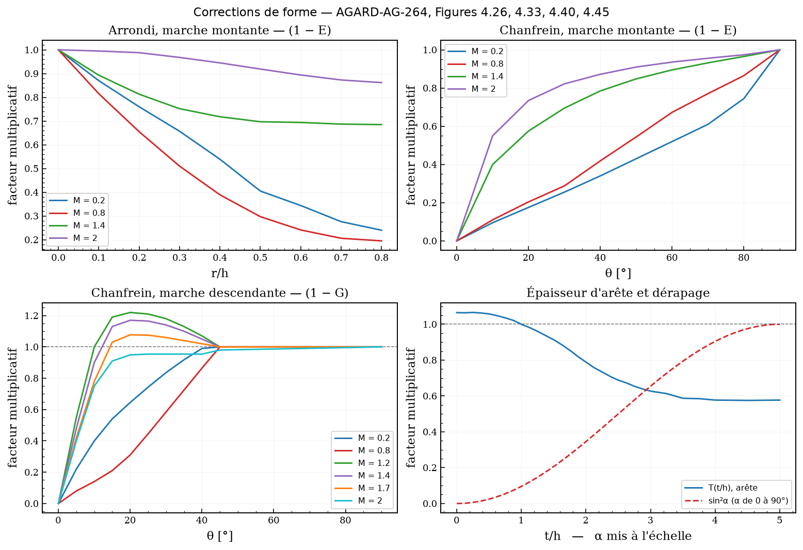
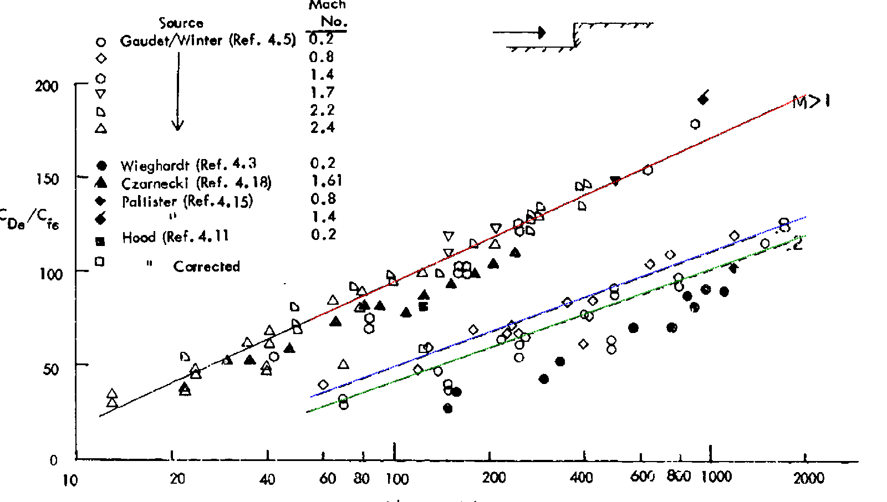
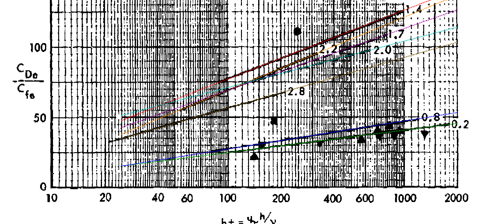
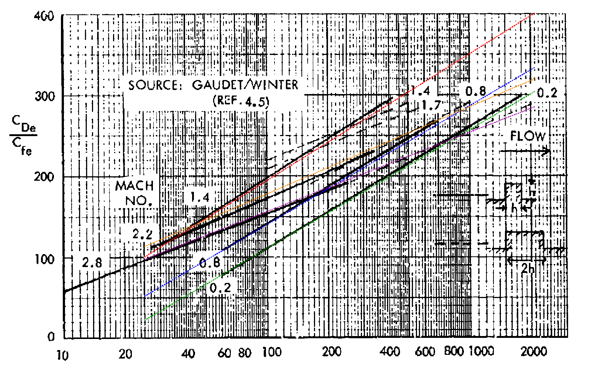

# cfd-aq — traînée des aspérités de surface

Un panneau ne se repose jamais parfaitement à fleur. `cfd-aq` chiffre ce que
la marche coûte, par la méthode de l'AGARDograph **AGARD-AG-264**,
*Aircraft Excrescence Drag* (A. D. Young & J. H. Paterson, AGARD/NATO, 1981),
§4.3 — les corrélations RAE (Gaudet & Winter) et ARA (Pallister). Le rapport
source est dans le dépôt : [`DTIC_ADA106030.pdf`](DTIC_ADA106030.pdf).



---

## Sommaire

1. [Installation](#1-installation)
2. [Prise en main en trois minutes](#2-prise-en-main-en-trois-minutes)
3. [Le principe de la méthode](#3-le-principe-de-la-méthode)
4. [Les géométries, une par une](#4-les-géométries-une-par-une)
5. [Les corrections de forme](#5-les-corrections-de-forme)
6. [Guide pratique](#6-guide-pratique)
7. [Les données numérisées et leur vérification](#7-les-données-numérisées-et-leur-vérification)
8. [Référence CLI, YAML, API Python](#8-référence-cli-yaml-api-python)
9. [Ce que la méthode ne couvre pas](#9-ce-que-la-méthode-ne-couvre-pas)
10. [Tests et validation](#10-tests-et-validation)

---

## 1. Installation

```bash
cd tools/cfd-aq
python3 -m venv .venv && source .venv/bin/activate
pip install -e ".[dev]"
```

### Les paquets frères de la suite

`cfd-aq` s'appuie sur deux autres paquets du dépôt. Ils ne sont pas publiés
sur PyPI, donc ils ne peuvent pas figurer en dépendance : on les installe à
la main, en *editable*, depuis `tools/`.

```bash
pip install -e ../cfd-atm -e ../cfd-plot
```

| Paquet | Ce qu'il apporte à cfd-aq | Sans lui |
| --- | --- | --- |
| [`cfd-atm`](../cfd-atm) | l'atmosphère : ISA ± ΔT, altitudes géométrique / géopotentielle / **pression**, et les conversions **Vc ↔ EAS ↔ TAS ↔ Mach** (Rayleigh pitot compris) | ISA géométrique de repli, 0 à 32 km ; tout le reste **refuse** en nommant la commande d'installation |
| [`cfd-plot`](../cfd-plot) | le style maison des figures, `plot_line`, `add_reference_lines`, `save_figure` | repli sur Matplotlib nu, figures correctes mais hors charte |

Le repli de l'atmosphère n'est pas un second modèle : un test
(`test_le_repli_et_cfd_atm_donnent_la_meme_isa`) les compare altitude par
altitude. Ce qu'il ne sait pas faire, il le dit — jamais un nombre faux en
silence.

Chaque rapport terminal commence par une ligne grise qui nomme ce qui est
réellement actif :

```
atmosphère : cfd-atm   —   figures : cfd-plot
```

> Le script de console peut être cassé par l'installation (pip grave
> `sys.executable` dans son shebang, ce qui est faux dès que Python vient
> d'une image Apptainer, d'un venv déplacé ou d'un chemin trop long).
> `python -m cfd_aq …` marche toujours.

---

## 2. Prise en main en trois minutes

```bash
# Le rapport de traînée nu, à (h⁺, Mach) donnés — aucune donnée d'écoulement
cfd-aq ratio --h-plus 500 --mach 0.8

# Une marche isolée : 1,5 mm sur 2,4 m, croisière FL360, 10 m de parcours turbulent
cfd-aq marche --type montante --hauteur 1.5e-3 --envergure 2.4 \
              --altitude 11000 --mach 0.82 --x 10 --surface-reference 122.6

# La même, saisie comme en vol : Vc au lieu du Mach, journée à ISA+15
cfd-aq marche --type montante --hauteur 1.5e-3 --envergure 2.4 \
              --altitude 11000 --vc 140.4 --delta-isa 15 --x 10

# Un cas complet, plusieurs aspérités, avec bilan
cfd-aq exemple mon_cas && cd mon_cas && cfd-aq run CAS_VOILURE.yaml
```

En Python :

```python
from cfd_aq import Asperite, CoucheLimite, EtatLocal, TypeAsperite, calculer_trainee

etat = EtatLocal.atmosphere(altitude=11000.0, mach=0.82)  # passe par cfd-atm
couche = CoucheLimite.plaque_plane(etat, distance_bord_attaque=10.0)

marche = Asperite(TypeAsperite.MONTANTE, hauteur=1.0e-3, envergure=1.0)
resultat = calculer_trainee(marche, etat, couche, surface_reference=122.6)

print(resultat.h_plus, resultat.cde_sur_cfe, resultat.trainee)
# 148.7   60.0   1.00 N
```

---

## 3. Le principe de la méthode

### 3.1 Pourquoi un nombre de Reynolds de rugosité

Une aspérité suffisamment petite ne « voit » pas la couche limite entière :
elle ne voit que la **région interne**, celle où le profil de vitesse ne
dépend que de la contrainte pariétale et de la viscosité. Sa traînée doit
donc se corréler sur les mêmes paramètres que cette région — et c'est ce que
les essais RAE et ARA ont montré.

On définit un **nombre de Reynolds de rugosité** — équation 4(25) :

```
h⁺ = u_τ · h / ν_w          avec   u_τ = √(τ_w / ρ_w)
```

bâti sur les grandeurs **à la paroi** : la vitesse de frottement et la
viscosité cinématique pariétale. Et un **rapport de traînée** :

```
CDe / Cfe        avec   CDe = ΔD / (q_e · f_e)   et   Cfe = τ_w / q_e
```

où `f_e = h × b` est l'aire frontale de l'aspérité et `q_e` la pression
dynamique au bord de la couche limite.

Tracé sous la forme `CDe/Cfe = f(h⁺)`, le nuage des essais se range sur des
**droites en log h⁺**, une par Mach — c'est la forme de l'équation 4(37) :

```
CDe / Cfe = A · log₁₀(h⁺) + B
```

### 3.2 La conséquence pratique

La pression dynamique disparaît du produit :

```
ΔD = (CDe/Cfe) · τ_w · f_e
```

Il suffit donc de connaître **τ_w** et **h⁺**. Rien d'autre. `q_e` n'apparaît
dans les rapports que parce qu'un ingénieur aime le lire.

### 3.3 Les trois bandes de Mach

| Bande | Traitement |
| --- | --- |
| `M ≤ 0,8` | lecture des droites tabulées, interpolation linéaire en Mach |
| `0,8 < M < 1,4` | mélange des droites M = 0,8 et M = 1,4 par un facteur **mesuré** |
| `M ≥ 1,4` | lecture des droites tabulées, interpolation en Mach |

Le mélange transsonique s'écrit, pour les trois formes — équations 4(27),
4(32) et 4(38) :

```
(CDe/Cfe)_M = (CDe/Cfe)_{M=0,8} + PC · [ (CDe/Cfe)_{M=1,4} − (CDe/Cfe)_{M=0,8} ]
```

avec PC₁ (Figure 4.25) pour la marche montante, PC₂ (Figure 4.30) pour la
descendante, PC₃ (Figure 4.38) pour l'arête. **PC₂ et PC₃ dépassent 1** : la
traînée passe par un maximum à l'intérieur de l'intervalle, au-dessus de sa
valeur à M = 1,4. PC₃ culmine à 1,58 vers M = 1,03.



---

## 4. Les géométries, une par une

### 4.1 Marche montante — `TypeAsperite.MONTANTE`

> §4.3.1.1 du rapport — Figures 4.23, 4.25, 4.26

L'écoulement arrive sur une surface qui **monte**. C'est le cas d'un panneau
posé en recouvrement dans le mauvais sens, d'un bord de trappe qui dépasse,
d'un couvre-joint rapporté.

```
CDe/Cfe = A · log₁₀(h⁺) + B          Figure 4.23, NUMÉRISÉ (± 3)
```

| M | A | B | CDe/Cfe à h⁺ = 100 | à h⁺ = 1000 |
| --- | --- | --- | --- | --- |
| 0,2 | 60,0 | −79,0 | 41,0 | 101,0 |
| 0,8 | 61,5 | −74,0 | 49,0 | 110,5 |
| ≥ 1,4 | 76,8 | −59,5 | 94,1 | 170,9 |

**Comportement en Mach :** la traînée croît jusqu'à M ≈ 1,4 puis **plafonne**.
Le rapport ne donne qu'une seule droite supersonique (§4.3.1.1.1 : « all the
data seem to be along a single line »), donc au-delà de 1,4 le Mach cesse
d'intervenir.

```python
from cfd_aq import ratio_marche_montante

ratio_marche_montante(h_plus=500.0, mach=0.8)  # 92.0
```

### 4.2 Marche descendante — `TypeAsperite.DESCENDANTE`

> §4.3.1.2 — Figures 4.28, 4.30, 4.32, 4.33

L'écoulement quitte une surface qui **descend** : un décrochement vers
l'arrière, l'aval d'un joint, la lèvre d'une trappe affleurante.

```
CDe/Cfe = A · log₁₀(h⁺) + B          Figure 4.28, NUMÉRISÉ (± 4)
```

| M | A | B | CDe/Cfe à h⁺ = 1000 |
| --- | --- | --- | --- |
| 0,2 | 16,0 | −7,5 | 40,5 |
| 0,8 | 20,0 | −13,0 | 47,0 |
| 1,4 | 49,0 | −21,2 | 125,8 |
| 1,7 | 52,0 | −35,2 | 120,8 |
| 2,0 | 44,0 | −19,2 | 112,8 |
| 2,2 | 33,0 | +4,8 | 103,8 |
| 2,8 | 36,0 | −15,8 | 92,2 |

**Comportement en Mach :** contrairement à la montante, la traînée passe par
un **maximum vers M ≈ 1,15** (PC₂ y vaut 1,27) puis redescend — §4.3.1.2.1 :
« the drag of rearward steps starts to decrease at M = 1.4 ».

À Mach subsonique, une marche descendante traîne **2 à 3 fois moins** qu'une
marche montante de même hauteur. C'est la seule bonne nouvelle de ce document.

### 4.3 Arête — `TypeAsperite.ARETE`

> §4.3.2 — Figures 4.34, 4.38, 4.40

Une marche montante suivie de près d'une marche descendante : un couvre-joint,
un cordon de mastic, une bande de protection, une plaque rapportée. Le
paramètre supplémentaire est l'épaisseur **t** (dans le sens de l'écoulement),
donnée par `t_sur_h`.

```
CDe/Cfe = T(t/h) · [ A · log₁₀(h⁺) + B ]      éq. 4(37) et 4(39)
```

Les coefficients de l'arête carrée (t = h) sont **imprimés dans le rapport**,
page 91 — ce ne sont pas des lectures de figure :

| M | A | B | CDe/Cfe à h⁺ = 1000 |
| --- | --- | --- | --- |
| 0,2 | 150 | −190 | 260,0 |
| 0,8 | 150 | −160 | 290,0 |
| 1,4 | 160 | −125 | 355,0 |
| 2,2 | 110 | −42 | 288,0 |
| 2,8 | 100 | −44 | 256,0 |

Le facteur d'épaisseur T(t/h) de la Figure 4.40 vaut 1 à t = h, culmine à
1,07 vers t/h ≈ 0,25 (une arête **mince** traîne un peu plus) et s'effondre
vers un plateau de 0,58 au-delà de t/h ≈ 4, où l'écoulement recolle entre les
deux faces.

### 4.4 Une arête n'est pas la somme de ses deux marches

C'est l'enseignement le plus utile du §4.3.2.1, et `cfd-aq` le reproduit.
Superposer une marche montante et une descendante donne, à bas Mach, **environ
la moitié** de la traînée mesurée d'une arête carrée de même hauteur : le
bulbe de recirculation de la face amont n'a pas recollé quand il rencontre la
face aval, et l'interférence pèse autant que les deux parties réunies.



| M | montante | descendante | somme | arête | **somme / arête** |
| --- | --- | --- | --- | --- | --- |
| 0,2 | 101,0 | 40,5 | 141,5 | 260,0 | **0,544** |
| 0,8 | 110,5 | 47,0 | 157,5 | 290,0 | **0,543** |
| 1,4 | 170,9 | 125,8 | 296,7 | 355,0 | **0,836** |
| 2,2 | 170,9 | 103,8 | 274,7 | 288,0 | **0,954** |
| 2,8 | 170,9 | 92,2 | 263,1 | 256,0 | **1,028** |

(à h⁺ = 1000 ; `interference_arete(1000.0, mach)`)

L'écart se résorbe avec le Mach et a disparu à M = 2,8 — ce que le rapport
écrit en toutes lettres : « *This difference subsides at the higher Mach
numbers and is not present in the M = 2.8 data.* »

C'est aussi, accessoirement, la meilleure vérification de la numérisation :
les droites des marches viennent de figures scannées, les coefficients de
l'arête d'une table imprimée, et c'est le rapport qui fixe la relation entre
les deux. Voir §7.

---

## 5. Les corrections de forme



| Correction | Paramètre | Équation | Effet |
| --- | --- | --- | --- |
| Arrondi, marche montante | `rayon_sur_h` | 4(28) | × (1 − E) — **réduit** |
| Chanfrein, marche montante | `angle_chanfrein` | 4(29) | × (1 − E) — **réduit** |
| Arrondi, marche descendante | `rayon_sur_h` | 4(34) | × (1 + 1,43·r/h) — **augmente** |
| Chanfrein, marche descendante | `angle_chanfrein` | 4(33) | × (1 − G) — nul au-dessus de 45° |
| Épaisseur d'arête | `t_sur_h` | 4(39) | × T(t/h) |
| Dérapage | `angle_derapage` | 4(30), 4(35), 4(41) | × sin²α |

Quelques ordres de grandeur, à M = 0,8 :

| Geste | Facteur |
| --- | --- |
| arrondir une marche montante à r/h = 0,4 | **0,39** (−61 %) |
| la même à M = 2,0 | 0,95 (−5 %) |
| casser une marche montante à θ = 30° | **0,29** (−71 %) |
| casser une marche descendante à θ = 30° | 0,59 (−41 %) |
| arrondir une marche descendante à r/h = 0,5 | **1,72** (+72 %) |
| aspérité en biais à α = 60° | 0,75 |

### Trois contre-intuitions

1. **Arrondir une marche descendante augmente sa traînée** (Figure 4.32). Le
   rapport n'en donne pas d'explication ; il constate, et la relation est
   unique, indépendante du Mach.
2. **Chanfreiner une marche descendante ne sert à rien jusqu'à 45°**, et entre
   12° et 45° cela l'*aggrave* légèrement au transsonique et au supersonique
   (facteur au-dessus de 1). La chute n'arrive qu'en dessous de 12°.
3. **Le bénéfice d'un arrondi s'effondre avec le Mach.** Ce qui gagne 60 % en
   subsonique n'en gagne plus que 5 % à M = 2.

Le rapport applique ces corrections **une à une** et ne dit jamais qu'elles se
composent. `cfd-aq` les multiplie — hypothèse d'ingénieur, signalée comme
telle dans le code et dans le rapport terminal, qui nomme chaque correction
active. Un arrondi **et** un chanfrein sur la même arête sont refusés : ce
n'est pas une géométrie que le rapport décrit.

---

## 6. Guide pratique

### 6.1 La question à se poser en premier : d'où vient τ_w ?

Trois entrées possibles, par ordre de qualité décroissante.

| Entrée | CLI | YAML | Quand |
| --- | --- | --- | --- |
| cisaillement pariétal | `--tau 16.6` | `cisaillement_paroi: 16.6` | vous avez un calcul RANS ou une mesure — **la voie exacte** |
| coefficient de frottement | `--cf 0.00155` | `cf: 0.00155` | vous avez C_fe local |
| distance au bord d'attaque | `--x 10` | `distance_bord_attaque: 10.0` | avant-projet : seule la géométrie est connue |

La troisième passe par une corrélation de plaque plane : loi en 1/7
`cf = 0,0592·Re_x^(−0,2)` évaluée à la **température de référence d'Eckert**,
puis ramenée aux conditions de bord par le rapport des masses volumiques.
Elle suppose une couche limite turbulente depuis le bord d'attaque, sans
gradient de pression. Sur un profil réel, aucune des trois hypothèses n'est
exacte.

Si vous sortez τ_w d'un calcul CFD, prenez-le **sur la configuration lisse**,
à l'abscisse de l'aspérité : la corrélation ajoute l'effet de la marche, elle
ne le remplace pas.

### 6.2 Les deux pièges, dans l'ordre d'importance

**① Les conditions demandées sont locales.** Mach, température et pression
sont ceux du **bord de couche limite à l'abscisse de l'aspérité**, pas ceux de
l'infini amont. Sur un extrados en croisière, le Mach local dépasse facilement
M∞ de 0,05 à 0,10 ; s'y tromper sous-estime la traînée d'un bon tiers. C'est,
de loin, la première source d'erreur devant toute l'incertitude des
corrélations.

**② Les corrélations sont à gradient de pression nul.** Toutes les données du
§4.3 viennent d'essais sur plaque plane. Sur un profil, ce que l'aspérité
ajoute à l'épaisseur de quantité de mouvement est transporté jusqu'au bord de
fuite et **amplifié en chemin**. Nash & Bradshaw (§5.1) donnent le facteur
d'amplification — équation 5(5) :

```
m_d = (u_eo/V₀)^4,2 · (V₀/u_eT) · (θ_o/θ_T)^(1/5)
```

qui vaut exactement 1 sur plaque plane et peut largement dépasser le
`(u_eo/V₀)²` que donnerait la simple proportionnalité à la pression dynamique
locale.

```python
from cfd_aq import facteur_amplification_nash_bradshaw

facteur_amplification_nash_bradshaw(1.25, 0.95, 0.4)  # 2.24
```

Il n'est **jamais appliqué d'office** : il demande des grandeurs au bord de
fuite que `cfd-aq` n'a aucun moyen de deviner. Passez-le par
`amplification=` ou `--amplification`.

### 6.3 Domaine de validité, et ce qui arrive en dehors

| Grandeur | Domaine | Origine |
| --- | --- | --- |
| h⁺ | 25 à 2000 | axes des Figures 4.23, 4.28, 4.34 |
| h⁺, marche montante **subsonique** | ≥ 55 | les tiretés de la Figure 4.23 ne sont pas tracés plus bas |
| h/δ | ≤ 0,03 | §4.3.1.1.1, essais RAE |
| M | 0,2 à 1,4 (montante) ; 0,2 à 2,8 (descendante, arête) | tables |
| couche limite | turbulente, 2-D, gradient de pression nul | toutes les données du §4.3 |

La borne basse à 25 n'est pas celle des axes, qui commencent à 10 : plus bas,
les droites **publiées** elles-mêmes prédisent une traînée nulle ou négative
— l'arête carrée à M = 0,2 s'annule à h⁺ = 18,5, la marche montante à M = 0,2
à h⁺ = 20,7. Le rapport ne les a jamais destinées à descendre là.

En dehors du domaine, `cfd-aq` renvoie quand même un nombre — la courbe la
plus proche est maintenue, la droite prolongée — mais :

- `verifier_domaine()` remonte **un avertissement par grandeur sortie** ;
- le rapport terminal les affiche dans un panneau jaune ;
- la CLI sort en **code 2**.

Le code 2 n'est pas un échec, c'est une invitation à lire le panneau. Ne le
masquez pas avec `|| true`.

### 6.4 Un ordre de grandeur à retenir

Croisière FL360, M = 0,82 local, 10 m de parcours turbulent :
`τ_w ≈ 16,6 Pa`, `δ ≈ 105 mm`, `C_fe ≈ 0,00155`.

| h | h⁺ | h/δ | CDe/Cfe | ΔD par mètre d'envergure |
| --- | --- | --- | --- | --- |
| 0,5 mm | 74 | 0,005 | 41,5 | 0,34 N |
| 1,0 mm | 149 | 0,009 | 60,0 | 1,00 N |
| 2,0 mm | 297 | 0,019 | 78,6 | 2,61 N |

La traînée croît **plus vite que la hauteur** : doubler h fait plus que
doubler ΔD, parce que `CDe/Cfe` grandit lui aussi avec `log h⁺`.

### 6.5 Un budget de traînée complet

`01_EXEMPLE/01_budget_trainee.py` fait l'exercice en entier : six joints de
11 m sur un extrados, le coût en *counts* en fonction de la hauteur, et ce
que rapporte un chanfrein. `01_EXEMPLE/02_arete_contre_deux_marches.py`
reproduit le tableau du §4.4 ci-dessus.

```bash
cfd-aq exemple mon_cas
cd mon_cas && ./RUN_EXEMPLE.sh
```

---

## 7. Les données numérisées et leur vérification

### 7.1 Deux provenances, qui ne se valent pas

**Publié** — imprimé en toutes lettres dans le rapport, exact à la
transcription près, et la transcription est vérifiée par un test :

| Donnée | Emplacement |
| --- | --- |
| `ARETE_CARREE` | table sous éq. 4(37), p. 91 |
| `ARETE_RECTANGULAIRE_2H` | même page |
| `RAPPORT_ARRONDI_DESCENDANTE` (1,43) | éq. 4(34), p. 87 |

**Numérisé** — lu sur une figure scannée. Les scans sont des reproductions
microfiches de 1981 : les courbes font 2 à 3 pixels de large sur une trame
pointillée. L'incertitude ci-dessous est celle de **la numérisation seule** ;
la dispersion expérimentale s'y ajoute, et le rapport la décrit lui-même
comme importante pour les marches descendantes (§4.3.1.2.1).

| Donnée | Figure | Méthode | Incertitude |
| --- | --- | --- | --- |
| `MARCHE_MONTANTE` | 4.23 | transformée de Hough sur le tracé isolé | ± 3 sur CDe/Cfe |
| `PC1_MARCHE_MONTANTE` | 4.25 | détection des symboles (érosion morphologique) | ± 0,01 |
| `ARRONDI_MONTANTE` | 4.26(a) | suivi de trait sur l'image ouverte | ± 0,03 |
| `CHANFREIN_MONTANTE` | 4.26(b) | idem | ± 0,04 |
| `MARCHE_DESCENDANTE` | 4.28 | Hough à pente sélective, extraction itérative des 7 droites | ± 4 sur CDe/Cfe |
| `PC2_MARCHE_DESCENDANTE` | 4.30 | détection des symboles | ± 0,02 |
| `CHANFREIN_DESCENDANTE` | 4.33 | lecture sur grille étalonnée | **± 0,05** |
| `PC3_ARETE` | 4.38 | suivi de trait continu | ± 0,02 |
| `EPAISSEUR_ARETE` | 4.40 | suivi de trait continu | ± 0,02 |

La table la moins sûre est `CHANFREIN_DESCENDANTE` : la Figure 4.33 superpose
sept courbes, leurs repères et leurs lignes de rappel dans un cadre de quatre
centimètres, et elles se croisent toutes au voisinage de G = 0. Le texte du
§4.3.1.2.2 y est plus net que le tracé, et la table le respecte. Si un cas
dépend de cette correction à mieux que ± 10 %, retournez à la figure.

### 7.2 La superposition sur les figures d'origine

C'est le contrôle décisif, et il est automatisé :

```bash
python 00_DOC/verifier_numerisation.py      # écrit dans 00_DOC/FIGURES/
```

Le script rend les figures du PDF à 400 dpi, les binarise, les réduit, puis
trace **en tiretés** les courbes du paquet par-dessus — le trait d'origine
reste visible dessous. Il faut `pdftoppm` (poppler-utils).

**Figure 4.23 — marche montante.** Les trois droites de `cfd-aq` recouvrent
les trois tracés du rapport sur toute la plage et aboutissent exactement aux
étiquettes « .2 », « .8 » et « M > 1 » :



**Figure 4.28 — marche descendante.** Les sept droites se posent sur les sept
tracés, de « 0.2 » à « 2.8 ». C'est la figure la plus serrée du lot : les
courbes 1,7 / 2,0 / 2,2 se croisent, et leur ordre a été fixé par la phrase du
§4.3.1.2.1 qui impose une traînée décroissante au-delà de M = 1,4 :



**Figure 4.34 — arête carrée.** Ici les coefficients sont **publiés** : la
superposition contrôle la transcription, pas une lecture. Le fond porte aussi
les droites de l'arête rectangulaire t = 2h, d'où plus de traits noirs que de
tiretés colorés :



### 7.3 Le recoupement qui ne dépend pas de la numérisation

Les droites des marches viennent de figures scannées ; les coefficients de
l'arête sont imprimés. Le rapport énonce la relation entre les trois
(§4.3.2.1) : la somme des deux marches est « *about 50 % below* » l'arête
carrée à bas Mach, et l'écart « *is not present in the M = 2.8 data* ».

Le paquet le reproduit **sans l'avoir ajusté** — tableau du §4.4 : 0,544 à
M = 0,2 et 1,028 à M = 2,8. Une erreur de numérisation de plus de ~5 % sur
l'une ou l'autre droite de marche casserait cet accord.

### 7.4 Une contradiction du rapport, laissée telle quelle

Pour une arête d'épaisseur t = 2h, AGARD-AG-264 donne deux routes
incompatibles :

- la **table dédiée** sous éq. 4(37), qui croise la droite de l'arête carrée
  vers h⁺ ≈ 1000 — plus traînante en dessous, moins au-dessus, exactement ce
  que décrit le §4.3.2.1 ;
- le produit générique **T(2) × (arête carrée)** de l'éq. 4(39), qui reste
  21 % sous l'arête carrée à tout h⁺.

Les deux diffèrent de 80 % à h⁺ = 100 et de 27 % à h⁺ = 1000. La raison est
dans le rapport : la courbe T vient des essais Wieghardt, tous à h/δ > 3 %
(Figure 4.39), alors que le croisement carrée/rectangulaire se situe entre
h/δ = 0,02 et 0,03.

`ratio_arete()` suit la route générique, la seule définie pour tout t/h.
`ratio_arete_rectangulaire_2h()` donne l'autre. L'écart est figé par un test,
pour qu'il ne se referme pas discrètement un jour.

### 7.5 Régénérer les planches

```bash
python 00_DOC/generer_figures.py        # les quatre planches du README
python 00_DOC/verifier_numerisation.py  # les trois superpositions (demande pdftoppm)
```

Elles sont versionnées pour que le README s'affiche sans rien installer — ce
qui veut dire qu'elles peuvent devenir obsolètes : régénérez-les après toute
modification de `cfd_aq/core/donnees.py`.

---

## 8. Référence CLI, YAML, API Python

### 8.1 Sous-commandes

| | |
| --- | --- |
| `cfd-aq ratio --h-plus 500 --mach 0.8 [--t-sur-h 1]` | le rapport CDe/Cfe nu, sans écoulement |
| `cfd-aq marche …` | la traînée d'une aspérité isolée |
| `cfd-aq run CAS.yaml [--figures RÉP]` | un cas complet, avec bilan |
| `cfd-aq check CAS.yaml` | valider un cas sans calculer |
| `cfd-aq figures RÉP` | tracer les corrélations du paquet |
| `cfd-aq exemple [RÉP]` | copier l'exemple prêt à l'emploi |

**Codes de sortie :** `0` tout va bien · `1` erreur d'entrée · `2` calcul
abouti mais au moins une extrapolation signalée.

### 8.2 Les options de `cfd-aq marche`

*Géométrie*

| Option | Défaut | |
| --- | --- | --- |
| `--type {montante,descendante,arete}` | — | obligatoire |
| `--hauteur` | — | h [m] |
| `--envergure` | — | b [m] |
| `--t-sur-h` | 1.0 | épaisseur d'arête |
| `--rayon-sur-h` | 0.0 | arrondi d'arête |
| `--chanfrein` | 90.0 | angle θ [°] ; 90° = arête vive |
| `--derapage` | 90.0 | angle α [°] ; 90° = en travers du flux |

*Écoulement* — une vitesse et une altitude (ou T et p)

| Option | |
| --- | --- |
| `--mach` | Mach local |
| `--vc` / `--tas` / `--eas` | Vc, TAS ou EAS [m/s] — **demande cfd-atm** |
| `--altitude` | altitude [m] |
| `--type-altitude {geometrique,geopotentielle,pression}` | **les deux dernières demandent cfd-atm** |
| `--delta-isa` | écart ΔT [K] — **demande cfd-atm** |
| `--temperature` / `--pression` | conditions statiques imposées, au lieu de l'altitude |

*Couche limite* — exactement une des trois

`--x` (distance au bord d'attaque [m]) · `--cf` · `--tau` [Pa],
plus `--temperature-paroi` [K] (adiabatique par défaut).

*Sortie*

`--surface-reference` [m²] pour le ΔCx · `--amplification` (m_d de
Nash-Bradshaw) · `--nom`.

### 8.3 Le fichier de cas YAML

```yaml
etude: "Jonctions de panneaux, extrados voilure, croisière FL360"

ecoulement:
  altitude: 11000        # m — géométrique par défaut
  mach: 0.88             # Mach LOCAL, pas M∞
  # Avec cfd-atm installé, trois libertés de plus :
  #   type_altitude: pression        # ou geopotentielle
  #   delta_isa: 15                  # journée chaude
  #   vitesse_conventionnelle: 140.4 # Vc [m/s] au lieu du Mach
  #   vitesse_vraie: 242.0           # TAS [m/s]
  #   vitesse_equivalente: 132.1     # EAS [m/s]
  # Ou bien, sans altitude du tout :
  #   temperature: 220.0
  #   pression: 25000.0

couche_limite:
  distance_bord_attaque: 8.5   # m — ou bien cf:, ou bien cisaillement_paroi:
  # temperature_paroi: 250.0
  # epaisseur: 0.09            # δ [m], pour le contrôle d'immersion

surface_reference: 122.6   # m² (facultatif)
amplification: 1.0         # m_d de Nash-Bradshaw (facultatif)

asperites:
  - nom: "Joint de panneau amont"
    type: montante          # montante | descendante | arete
    hauteur: 0.0012
    envergure: 11.0
    # t_sur_h: 1.0
    # rayon_sur_h: 0.0
    # angle_chanfrein: 90.0
    # angle_derapage: 90.0
```

Toute clé inconnue est **refusée** en nommant celles qui sont admises : un
`rayon:` mal orthographié qui garderait silencieusement sa valeur par défaut
changerait la réponse de dizaines de pour-cent, et c'est exactement le genre
d'erreur qu'un budget de traînée ne rattrape jamais.

### 8.4 API Python

*Écoulement et couche limite*

```python
EtatLocal.atmosphere(altitude, mach=|vitesse_conventionnelle=|vitesse_vraie=|
                     vitesse_equivalente=, delta_isa=0.0, type_altitude="geometrique")
EtatLocal(mach=, temperature=, pression=, gamma=1.4, r_gaz=287.05, prandtl=0.72)

CoucheLimite.depuis_cisaillement(etat, tau_w, temperature_paroi=None, epaisseur=None)
CoucheLimite.depuis_cf(etat, cf, ...)
CoucheLimite.plaque_plane(etat, distance_bord_attaque, temperature_paroi=None)
```

*Corrélations nues*

```python
ratio_marche_montante(h_plus, mach)
ratio_marche_descendante(h_plus, mach)
ratio_arete(h_plus, mach, t_sur_h=1.0)
ratio_arete_rectangulaire_2h(h_plus, mach)
interference_arete(h_plus, mach)  # (arête, somme, rapport)
```

*Corrections*

```python
facteur_arrondi_montante(r_sur_h, mach)  # (1 − E)
facteur_chanfrein_montante(angle, mach)  # (1 − E)
facteur_arrondi_descendante(r_sur_h)  # (1 + 1,43·r/h)
facteur_chanfrein_descendante(angle, mach)  # (1 − G)
facteur_epaisseur_arete(t_sur_h)  # T
facteur_derapage(angle)  # sin²α
```

*Assemblage*

```python
Asperite(type_asperite, hauteur, envergure, t_sur_h=1.0, rayon_sur_h=0.0,
         angle_chanfrein=90.0, angle_derapage=90.0)
calculer_trainee(asperite, etat, couche_limite, surface_reference=None,
                 amplification=1.0) -> ResultatTrainee
verifier_domaine(type_asperite, h_plus, mach, immersion=None) -> list[Avertissement]
facteur_amplification_nash_bradshaw(ue_o/V0, ue_T/V0, θ_o/θ_T)
```

`ResultatTrainee` porte `h_plus`, `immersion`, `cde_sur_cfe`,
`facteur_forme`, `cde`, `cisaillement_paroi`, `trainee` [N], `delta_cx` et
`avertissements`.

---

## 9. Ce que la méthode ne couvre pas

Le rapport va bien au-delà de ce paquet, qui s'arrête aux marches et aux
arêtes.

| Sujet | § du rapport |
| --- | --- |
| Rivets, vis, cylindres, trous, antennes | 4.2 |
| Jeux et rainures | 4.3.3 |
| Ondulations de surface | 4.3.4 |
| Rugosité distribuée, grain de sable équivalent | 3, 5.5 |
| Transition déclenchée par l'aspérité (k_crit.1, k_crit.2) | 2.2 |
| Effet sur le CL_max | 5.3 |
| Entrées et sorties d'air auxiliaires, fuites | 6 |
| Arêtes arrondies ou chanfreinées (Figures 4.41 à 4.44) | 4.3.2.2 |
| Arêtes multiples en série | 4.3.2.4 |

Le dernier point mérite une mise en garde : plusieurs arêtes rapprochées ne
s'additionnent pas. La Figure 4.46 montre un **espacement critique** vers
s ≈ 10 h où la traînée totale est maximale. Sommer les contributions
individuelles de joints régulièrement espacés est optimiste dans cette zone.

---

## 10. Tests et validation

```bash
pytest                       # 332 tests
ruff check . && ruff format --check .
mypy src tests               # strict
```

La suite est organisée en trois niveaux :

1. **Ancrages de définition** — ce que la figure impose par construction :
   PC = 0 à M = 0,8 et 1 à M = 1,4, T(1) = 1, E(r/h = 0) = 0, E(θ = 90°) = 0,
   G(θ = 0) = 1, monotonie de chaque courbe, positivité de chaque pente.
2. **Énoncés du rapport en prose** — les 50 % d'écart arête/marches à bas
   Mach, leur disparition à M = 2,8, le plateau de la marche montante au-delà
   de M = 1,4, le maximum de la descendante vers M = 1,15, le chanfrein aval
   sans effet jusqu'à 45°. Ces tests croisent une figure numérisée avec une
   table publiée : ils valident la numérisation sans en dépendre.
3. **Ancrages de régression** — une quinzaine de valeurs de `CDe/Cfe` figées.
   Les déplacer, c'est modifier la physique annoncée ; cela doit être
   délibéré.

S'y ajoutent la cohérence de l'ISA de repli avec `cfd-atm` altitude par
altitude, l'exécution réelle des scripts d'exemple en sous-processus, et le
refus documenté de chaque entrée invalide.

Et la vérification qui compte vraiment, celle de la numérisation elle-même,
est au §7.2.

---

## Contenu du dépôt

```
cfd-aq/
├── README.md                        ce document
├── DTIC_ADA106030.pdf               le rapport source, AGARD-AG-264
├── 00_DOC/
│   ├── FIGURES/                     les planches du README (versionnées)
│   ├── generer_figures.py           les régénère
│   └── verifier_numerisation.py     superpose les courbes aux scans du PDF
├── 02_ANNEXE/
│   ├── ANNEXE_TRAINEE_MARCHES.docx  l'annexe de rapport, 30 pages, FR
│   ├── trainee_marches.py           le calcul en un seul fichier, autonome
│   ├── FIGURES/                     captures, superpositions, extractions
│   └── outils/                      extraction des figures, construction du docx
├── src/cfd_aq/
│   ├── core/
│   │   ├── atmosphere.py            passerelle vers cfd-atm, + ISA de repli
│   │   ├── couche_limite.py         EtatLocal, CoucheLimite, h⁺, τ_w
│   │   ├── donnees.py               TOUTES les données AGARD, avec provenance
│   │   ├── marches.py               les corrélations et les corrections
│   │   └── trainee.py               assemblage géométrie × couche limite → ΔD
│   ├── data/cas.py                  lecture et validation du YAML
│   ├── report/                      rapport Rich (FR) et figures (cfd-plot)
│   ├── cli/main.py                  la ligne de commande
│   └── 01_EXEMPLE/                  cas voilure, budget de traînée, interférence
└── tests/                           332 tests
```

---

*AGARD-AG-264 est un rapport OTAN en diffusion publique
(« Approved for public release; distribution is unlimited »).*
