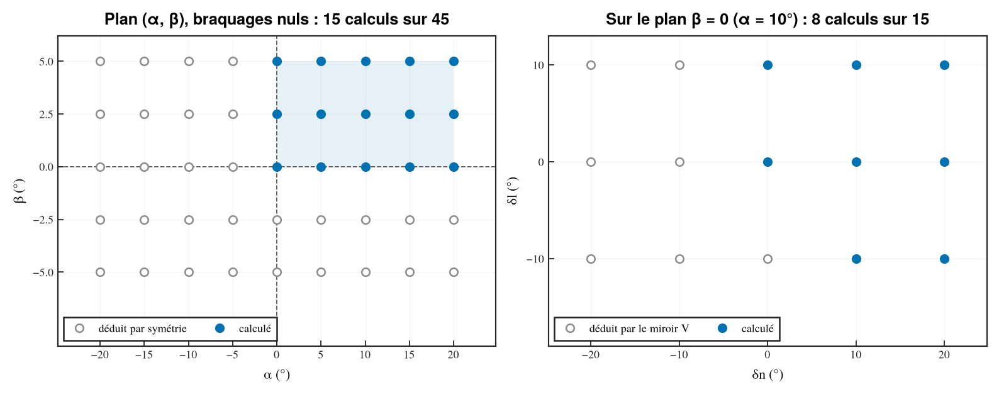
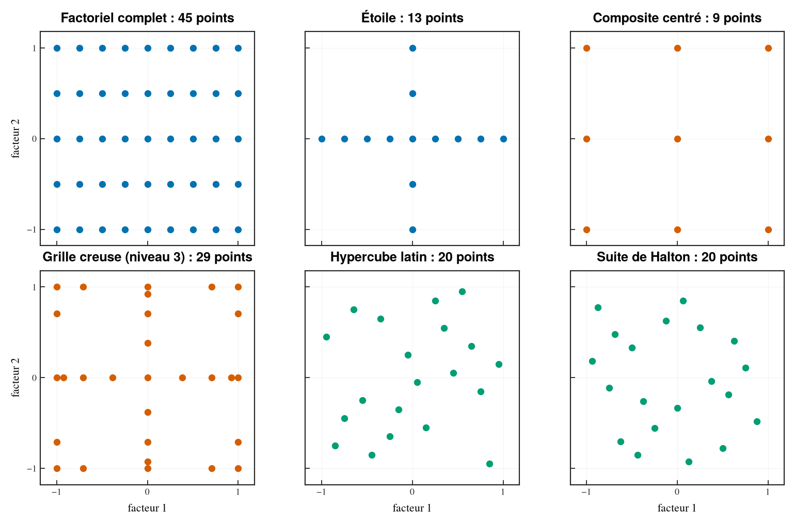
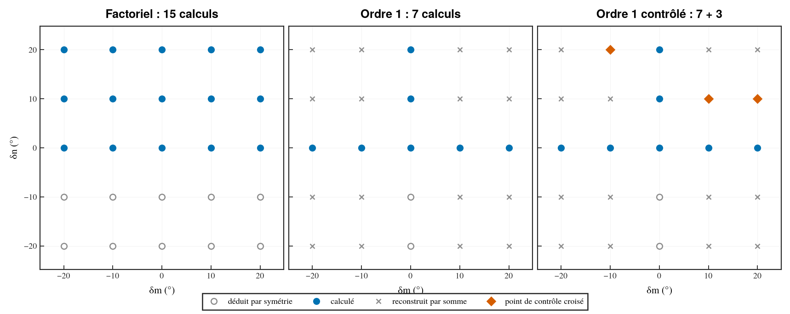
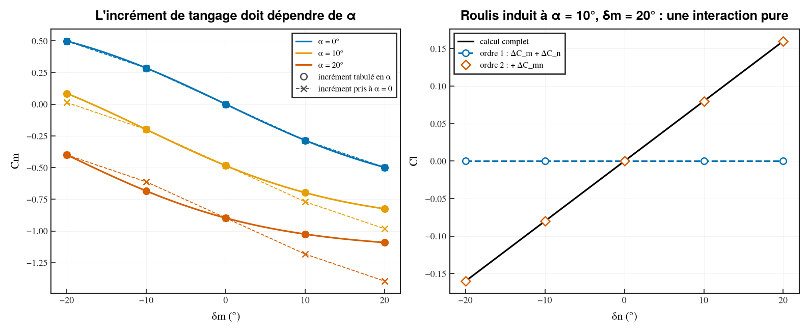
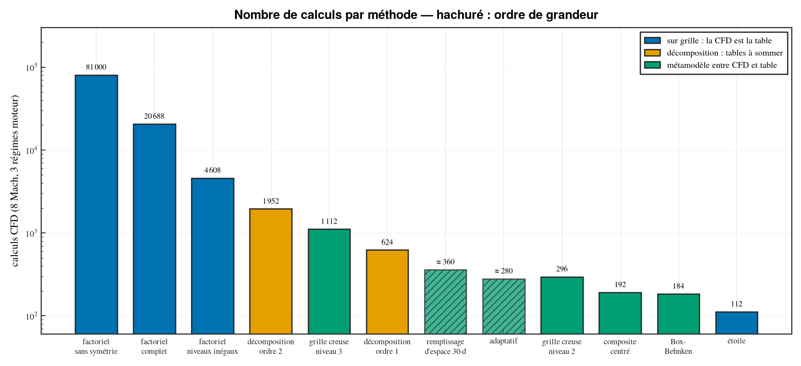
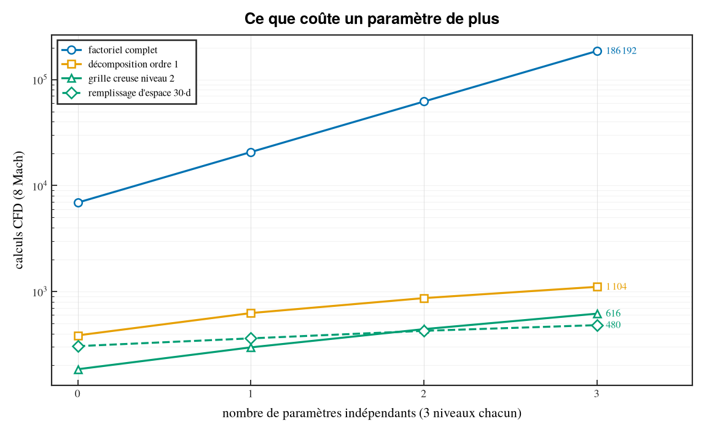
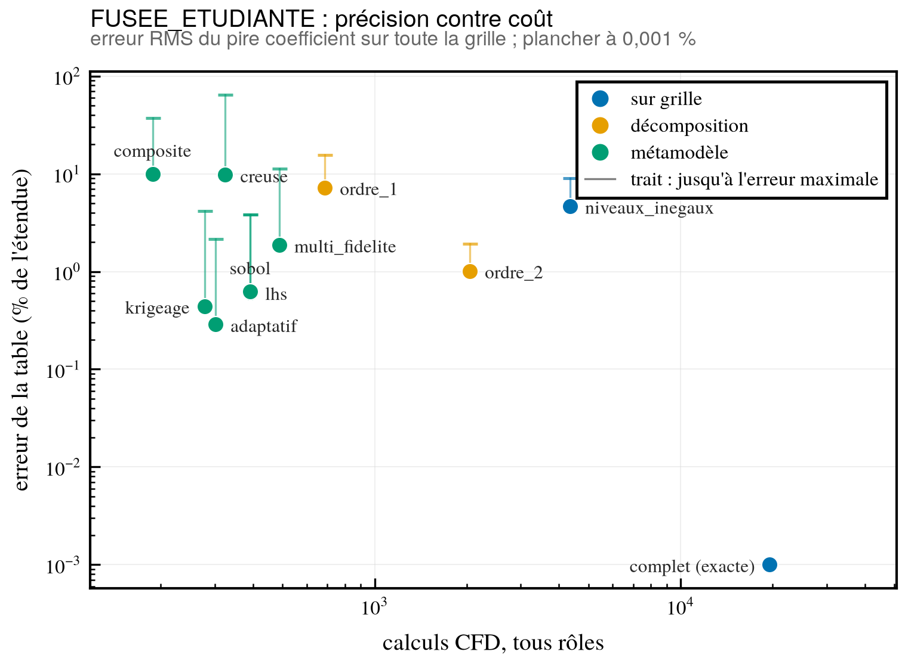
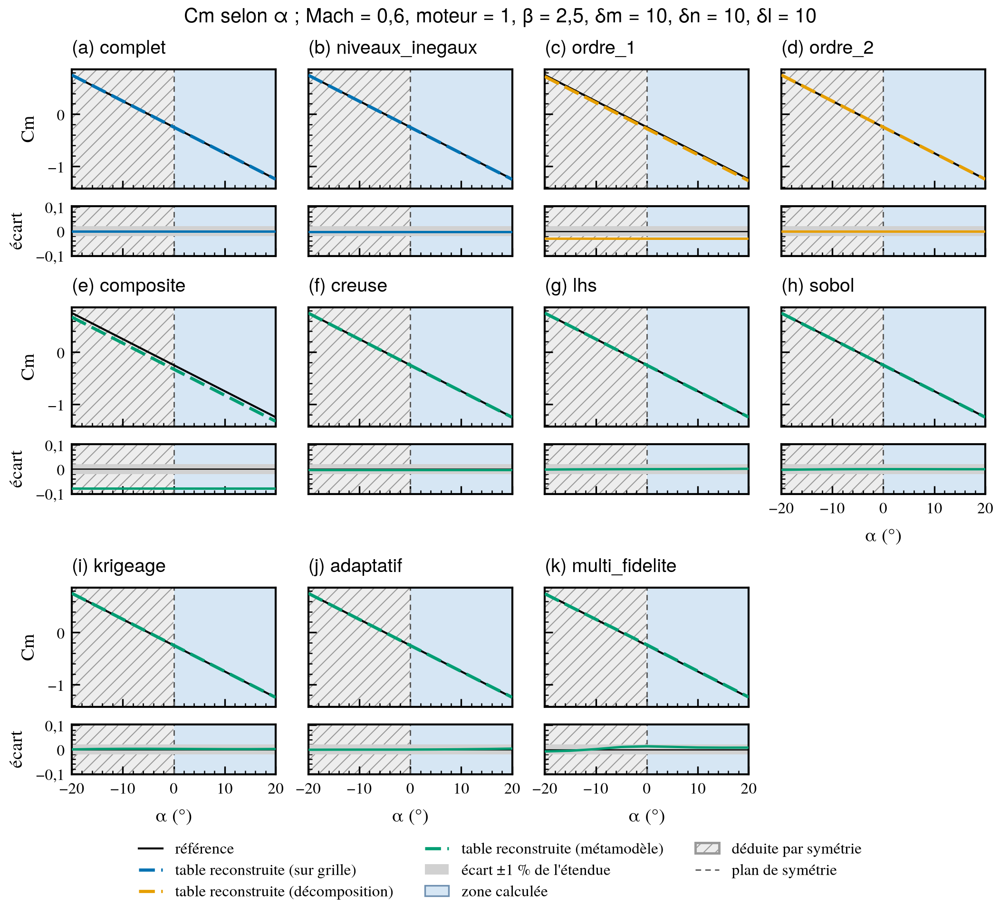

# Remplir les sous-domaines : du factoriel complet au plan adaptatif

`cfd-doe domaine` dit **où** calculer : les sous-domaines que les symétries ne permettent pas de
déduire. Ce document dit **combien de points y mettre, et lesquels**, une fois ajoutés le Mach et
des paramètres indépendants (un paramètre moteur, par exemple). Les méthodes vont de la plus
simple à la plus sophistiquée ; chacune est chiffrée sur le même exemple.

Toutes ces méthodes sont disponibles dans `cfd-doe remplir` (README §8) : un fichier de
remplissage nomme les plans à comparer, et l'outil produit le rapport, le fichier DOE du plan
retenu et les figures. L'exemple de ce document est celui de
`01_EXEMPLE/REMPLISSAGE_FUSEE.yaml`, à une géométrie près.

Ce qui change d'une méthode à l'autre n'est pas seulement le nombre de calculs : c'est
**l'hypothèse qu'on accepte sur la forme des coefficients**. Moins on calcule, plus l'hypothèse
est forte. Chaque section la nomme, et dit comment la contrôler.

## Sommaire

1. [L'exemple fil rouge](#1-lexemple-fil-rouge)
2. [Quatre points à trancher avant de choisir](#2-quatre-points-à-trancher-avant-de-choisir)
3. [Méthodes à grille](#3-méthodes-à-grille)
4. [Décomposition : un effet après l'autre](#4-décomposition--un-effet-après-lautre)
5. [Plans pour surface de réponse](#5-plans-pour-surface-de-réponse)
6. [Grilles creuses](#6-grilles-creuses)
7. [Remplissage d'espace et métamodèle](#7-remplissage-despace-et-métamodèle)
8. [Plans adaptatifs et multi-fidélité](#8-plans-adaptatifs-et-multi-fidélité)
9. [Synthèse et guide de choix](#9-synthèse-et-guide-de-choix)
10. [Avec n paramètres indépendants](#10-avec-n-paramètres-indépendants)
11. [Des calculs aux tables](#11-des-calculs-aux-tables)

---

## 1. L'exemple fil rouge

Engin à double symétrie (plans vertical et horizontal), simulé en 6DOF, traité en repère
cartésien :

```bash
cfd-doe domaine --traj 6DOF --sym double_symetrie \
    --alpha -20 20 --beta -5 5 --dl -10 10 --dm -20 20 --dn -20 20
```

Le groupe est D2 (miroir V, miroir H, rotation de 180°) : le domaine est divisé par 4, en
8 sous-domaines.

| # | Sous-domaine | α | β | δm | δn | δl | dim |
|---|---|---|---|---|---|---|---|
| 1 | général | ]0;20] | ]0;5] | [−20;20] | [−20;20] | [−10;10] | 5 |
| 2 | plan β = 0 | ]0;20] | 0 | [−20;20] | ]0;20] | [−10;10] | 4 |
| 3 | plan β, δn = 0 | ]0;20] | 0 | [−20;20] | 0 | [0;10] | 3 |
| 4 | plan α = 0 | 0 | ]0;5] | ]0;20] | [−20;20] | [−10;10] | 4 |
| 5 | plan α, δm = 0 | 0 | ]0;5] | 0 | [−20;20] | [0;10] | 3 |
| 6 | plan α, β = 0 | 0 | 0 | ]0;20] | ]0;20] | [−10;10] | 3 |
| 7 | plan α, β, δn = 0 | 0 | 0 | [0;20] | 0 | [0;10] | 2 |
| 8 | plan α, β, δm = 0 | 0 | 0 | 0 | ]0;20] | [0;10] | 2 |

On y ajoute :

- le **Mach**, 8 valeurs : 0,6 · 0,8 · 0,95 · 1,05 · 1,2 · 1,5 · 2 · 3 ;
- un **paramètre moteur** p (coefficient de poussée, rapport de pression du jet…), 3 niveaux :
  éteint, régime intermédiaire, plein régime. Une *condition* est un couple (Mach, p) : il y en
  a 24.

**Grille de référence** des cinq angles (degrés), celle qu'on voudrait dans la table finale :

| Variable | Niveaux | Nombre |
|---|---|---|
| α | −20 à 20 par pas de 5 | 9 |
| β | −5 à 5 par pas de 2,5 | 5 |
| δm, δn | −20 · −10 · 0 · 10 · 20 | 5 chacun |
| δl | −10 · 0 · 10 | 3 |

Soit 9 × 5 × 5 × 5 × 3 = 3 375 points par condition, **81 000 calculs** sans rien exploiter.
C'est le chiffre à battre.

**Règle de décompte.** Un nombre « avec symétries » est un nombre d'**orbites** : deux points
images l'un de l'autre par une symétrie de l'engin ne comptent qu'une fois. C'est exactement le
nombre de points du plan qui tombent dans les 8 sous-domaines. Tous les chiffres exacts de ce
document sortent de `00_DOC/compter_remplissage.py`, qui vérifie cette égalité ; les chiffres
donnés comme ordres de grandeur (sections 7 et 8) sont signalés comme tels.



*À gauche, le plan (α, β) à braquages nuls : seul le quadrant α ≥ 0, β ≥ 0 est calculé, les trois
autres s'en déduisent. À droite, sur le plan de symétrie β = 0, le miroir V relie (δn, δl) à
(−δn, −δl) : il reste 8 combinaisons sur 15. C'est ce second effet qui produit les sous-domaines
2 à 8.*

---

## 2. Quatre points à trancher avant de choisir

### 2.1 Le Mach n'est pas une variable comme les autres

- **Il n'est concerné par aucune symétrie** : il multiplie le plan, il ne le réduit pas.
- **Les coefficients n'y sont pas lisses** : autour de Mach 1 les chocs se déplacent, les
  gradients sont forts, parfois discontinus. Un modèle lisse (polynôme, krigeage à noyau régulier)
  qui traverse le transsonique est suspect. D'où des niveaux **resserrés** vers Mach 1 (0,8 ·
  0,95 · 1,05 · 1,2) et lâches au-delà.
- **Conséquence pratique** : sauf mention contraire, toutes les méthodes ci-dessous traitent le
  Mach **par tranches** — le même plan à chaque Mach, ou un plan décalé d'un Mach à l'autre. C'est
  aussi ce qui donne une table par Mach, le format habituel d'un simulateur.
- **Le domaine peut dépendre du Mach** : l'incidence maximale utile en supersonique élevé est
  rarement celle du subsonique. Réduire α max à Mach 3 est le levier le moins cher qui soit ; il se
  traite par une étude `cfd-doe` par plage de Mach.

### 2.2 Les paramètres indépendants : discret ou continu, et invariant

- **Discret** (moteur allumé/éteint, configuration avec ou sans carénage) : q niveaux
  multiplient le plan par q, quelle que soit la méthode. Rien à optimiser, sinon se demander si
  chaque niveau mérite le plan complet (voir la décomposition, section 4).
- **Continu** (poussée, pression du jet, altitude via le Reynolds) : c'est une **dimension de
  plus**. Les méthodes des sections 5 à 8 la traitent comme les angles ; les méthodes à grille la
  discrétisent en q niveaux.
- **Invariant par les symétries** : un paramètre n'est « indépendant » que s'il ne change pas
  quand on applique un miroir à l'engin. Un moteur dans l'axe l'est. Un jet latéral unique, une
  tuyère orientable ou une gouverne isolée **ne le sont pas** : soit le paramètre casse la
  symétrie (la géométrie déclarée à `cfd-doe` doit alors être moins symétrique), soit il change
  de signe par un miroir et doit être traité comme un braquage.

### 2.3 Table carrée ou métamodèle

Le simulateur lit des tables : une grille produit, une valeur par nœud.

- Les méthodes des **sections 3 et 4** calculent sur des nœuds de grille. Après
  `completer_table.py` (README §7), la table est directement lisible. La décomposition donne
  plusieurs petites tables carrées, à sommer.
- Les méthodes des **sections 5 à 8** calculent ailleurs que sur les nœuds. Entre les calculs et
  la table, il faut un **métamodèle** (polynôme, interpolant creux, krigeage) qu'on évalue ensuite
  sur la grille de son choix. La table devient une sortie du métamodèle : aussi fine qu'on veut,
  mais entachée de son erreur, qu'il faut mesurer.

C'est la vraie ligne de partage : en dessous, la CFD est la table ; au-dessus, la CFD nourrit un
modèle.

### 2.4 Les sous-domaines de petite dimension

Sept des huit sous-domaines sont des plans (β = 0, α = 0…). Ils ont un volume nul, mais ce sont
les régimes les plus fréquentés : le vol dans le plan de tangage est le sous-domaine 2.

- Sur une **grille**, rien à faire : les nœuds β = 0 en font partie, et les bornes ouvertes des
  sous-domaines garantissent qu'ils ne sont comptés qu'une fois.
- Sur un **tirage** (section 7), un point tiré au hasard ne tombe jamais sur un plan. Il faut y
  affecter des points volontairement.

### 2.5 Vue d'ensemble des plans



*Les familles de ce document, réduites à deux facteurs. En bleu, les plans sur grille (section 3) ;
en orange, les plans structurés qui demandent un modèle (sections 5 et 6) ; en vert, le
remplissage d'espace (section 7). En dimension 2 le composite centré se confond avec une grille
3 × 3 : c'est en dimension 5 ou 6 qu'il s'en écarte, en ne gardant qu'une fraction des sommets.
La grille creuse concentre ses points sur les axes, donc sur les plans de symétrie.*

---

## 3. Méthodes à grille

### 3.1 Factoriel complet

Tous les nœuds de la grille de référence, à chaque condition.

- **Hypothèse** : aucune, au-delà du pas de grille (interpolation linéaire entre nœuds).
- **Décompte** : 862 points par condition dans les sous-domaines (3 375 sans symétrie ; le
  rapport, 3,9, n'est pas tout à fait 4 parce que les points des plans de symétrie sont leur
  propre image). Soit 862 × 24 = **20 688 calculs**.
- **Pour** : aucune reconstruction, aucun modèle, toutes les interactions capturées.
- **Contre** : le coût, et il croît comme le produit des niveaux — un niveau de plus sur δm
  ajoute 20 %.

| | Par condition | Total (24 conditions) |
|---|---|---|
| Sans symétrie | 3 375 | 81 000 |
| Dans les sous-domaines | 862 | 20 688 |

### 3.2 Factoriel à niveaux inégaux

Même principe, mais on ne paie la finesse que là où le coefficient varie. Les niveaux se
décident variable par variable :

- **α** : la non-linéarité principale (portance tourbillonnaire, décrochage) — garder le pas fin ;
- **β** sur ±5° : quasi linéaire — 3 niveaux (−5, 0, 5) ;
- **δm, δn** : 3 niveaux (−20, 0, 20) si l'efficacité est proche du linéaire, sinon 5 ;
- **δl** : 3 niveaux.

Avec 9 × 3 × 3 × 3 × 3 = 729 nœuds bruts, il reste 192 points par condition dans les
sous-domaines, soit **4 608 calculs**.

- **Hypothèse** : linéarité par morceaux entre −20 et 0 et entre 0 et 20 pour les braquages.
  Une saturation de gouverne à 15° passe inaperçue.
- **Contrôle** : quelques polaires à 5 niveaux de braquage, à deux ou trois Mach.

### 3.3 Étoile : un facteur à la fois

Un point central (tout à zéro), et chaque variable balayée seule, les autres restant nulles.

- **Décompte** : 12 points par Mach moteur éteint (4 en α, 2 en β, 2 en δm, 2 en δn, 1 en δl,
  plus le centre), 2 de plus pour les niveaux moteur : 14 par Mach, **112 calculs**.
- **Hypothèse** : tous les effets s'ajoutent, **y compris celui de l'incidence** : l'efficacité
  d'une gouverne mesurée à α = 0 vaut à α = 20°. C'est faux pour un engin réel.
- **Usage** : un dégrossissage (quelles variables comptent, où est la non-linéarité), jamais une
  base aéro. Elle sert ici de borne inférieure, et d'introduction à la section suivante, qui en
  est la version sérieuse.

---

## 4. Décomposition : un effet après l'autre

### 4.1 Le principe

On écrit le coefficient comme une base plus des incréments, chacun ne dépendant que de
quelques variables :

```
C(M, α, β, δm, δn, δl, p) = C0(M, α, β)                   base : gouvernes à zéro, moteur éteint
                          + ΔC_m(M, α, δm)                 effet du braquage de tangage
                          + ΔC_n(M, α, δn)                 … de lacet
                          + ΔC_l(M, α, δl)                 … de roulis
                          + ΔC_p(M, α, β, p)               effet moteur
                          (+ termes croisés choisis)
```

Chaque incrément se mesure par différence, sur une table de petite dimension :
`ΔC_m(M, α, δm) = C(M, α, β=0, δm, 0, 0, p=0) − C0(M, α, 0)`. Contrairement à l'étoile, **tous les
incréments dépendent du Mach et de l'incidence** : c'est ce qui rend la méthode utilisable.

La même idée porte d'autres noms : *build-up* en aérodynamique, développement ANOVA tronqué ou
*cut-HDMR* en mathématiques. Tronquer à l'ordre 1, c'est négliger les interactions ; à l'ordre 2,
ne garder que les interactions deux à deux.

Les symétries s'appliquent à chaque table séparément, et y sont plus efficaces que sur le plan
complet : à β = 0 et δn = δl = 0, un braquage de tangage seul laisse l'écoulement symétrique par
rapport au plan vertical, donc CY, Cl et Cn sont nuls sans calcul.

### 4.2 Ordre 1 : aucune interaction entre effets

| Table | Variables | Points par Mach |
|---|---|---|
| Base C0 | (α, β), quadrant α ≥ 0, β ≥ 0 | 15 |
| ΔC_m | (α, δm ≠ 0) à β = 0 | 18 |
| ΔC_n | (α, δn ≠ 0) à β = 0 | 10 |
| ΔC_l | (α, δl ≠ 0) à β = 0 | 5 |
| ΔC_p | base refaite aux 2 régimes moteur | 30 |
| **Total** | | **78** |

Soit 78 × 8 = **624 calculs**, 33 fois moins que le factoriel complet.



*Le plan (δm, δn) à α = 10°, β = 0, δl = 0. Le factoriel calcule tous les nœuds (15, les 10
autres étant leurs images). L'ordre 1 ne calcule que les deux axes — 7 calculs — et reconstruit
les 16 nœuds hors axes par somme : ce sont eux qui portent l'hypothèse. Les points de contrôle
croisés (section 4.4) en vérifient quelques-uns.*

**Hypothèses**, toutes nécessaires :

1. **Les braquages ne se parlent pas** : l'effet de δm est le même que δn et δl soient braqués ou
   non.
2. **L'efficacité des gouvernes ne dépend pas du dérapage** : les incréments sont mesurés à
   β = 0 et appliqués à tout β.
3. **L'effet moteur ne dépend pas des braquages** : il est mesuré gouvernes à zéro.

Ce qui n'est **pas** supposé : la linéarité en braquage (chaque niveau est calculé), ni
l'indépendance vis-à-vis du Mach et de l'incidence.

**Où ça casse**, par ordre de fréquence :

- **grands braquages à grande incidence** : la gouverne au vent sature ou décroche, celle sous le
  vent est dans le sillage du corps — l'incidence locale est α + δ, et rien n'est additif ;
- **roulis induit** : braquer tangage et lacet ensemble, en incidence, crée du roulis que ni
  ΔC_m ni ΔC_n ne contiennent — c'est une interaction pure, et Cl est le coefficient le plus
  sensible à cette hypothèse ;
- **transsonique** : les chocs sur une gouverne modifient l'écoulement sur ses voisines ;
- **jet moteur et gouvernes arrière** : le jet modifie la pression de culot et entraîne
  l'écoulement autour des empennages ; l'hypothèse 3 est la plus fragile si les gouvernes sont
  près de la tuyère.



*Illustration sur un modèle analytique factice (gouverne dont l'efficacité sature avec
l'incidence locale α + δm ; roulis proportionnel à α·δm·δn). À gauche : un incrément tabulé en
fonction de α (ronds) suit la saturation, alors qu'un incrément mesuré à α = 0 et appliqué
partout (croix, l'étoile de la section 3.3) s'en écarte dès α = 10°. À droite : le roulis induit
n'existe que si tangage et lacet sont braqués ensemble ; l'ordre 1 prédit zéro quel que soit le
nombre de niveaux, et seule la table croisée ΔC_mn de l'ordre 2 le retrouve.*

### 4.3 Ordre 2 : les interactions qu'on choisit

On lève une hypothèse à la fois, en ajoutant la table qui la remplace.

| Table | Hypothèse levée | Points par Mach |
|---|---|---|
| Base C0 (α, β) | — | 15 |
| ΔC_m (α, β, δm) | 2, pour le tangage | 54 |
| ΔC_n (α, β, δn) | 2, pour le lacet | 50 |
| ΔC_l (α, β, δl) | 2, pour le roulis | 23 |
| ΔC_mn (α, δm, δn) à β = 0 | 1, pour le couple tangage × lacet | 36 |
| ΔC_p (α, β, p) | — | 30 |
| ΔC_pm (α, δm, p) à β = 0 | 3, pour le tangage | 36 |
| **Total** | | **244** |

Soit 244 × 8 = **1 952 calculs**. Le terme croisé se mesure aussi par différence :
`ΔC_mn = C(α, δm, δn) − C0 − ΔC_m − ΔC_n`.

Rien n'oblige à tout prendre : la liste est un menu. Chaque ligne se décide sur un critère
physique (les gouvernes sont-elles près de la tuyère ? le roulis induit est-il dimensionnant ?)
ou, mieux, sur les calculs de contrôle ci-dessous.

### 4.4 Contrôler les hypothèses

Une décomposition non contrôlée est un pari. Le contrôle coûte peu :

- **Points croisés** : 10 à 15 % du budget en points où *plusieurs* variables sont non nulles à
  la fois, tirés dans les sous-domaines (un petit hypercube latin, section 7). On compare le
  calcul à la somme des incréments. L'écart mesure directement l'erreur d'additivité, coefficient
  par coefficient.
- **Où les mettre** : aux coins qui inquiètent — α max, braquages max, transsonique, plein
  régime moteur.
- **Lecture** : un écart inférieur à l'incertitude CFD valide l'ordre ; sinon on identifie la
  paire de variables responsable et on ajoute sa table (section 4.3). C'est une démarche
  séquentielle : on ne paie l'ordre 2 que là où l'ordre 1 échoue.

Pour l'ordre 1 de l'exemple : 78 points par Mach, plus une dizaine de points croisés, soit
environ **700 calculs** contrôle compris.

### 4.5 Vers la table du simulateur

Deux façons de livrer :

- **Les tables d'incréments telles quelles** : chacune est une petite table carrée (après
  `completer_table.py`), et le simulateur fait la somme. C'est la forme la plus légère, et elle
  garde la trace de ce qui a été mesuré.
- **Une grande table carrée reconstruite** : on évalue la somme sur la grille de référence. Elle
  est lisible par n'importe quel lecteur, mais elle masque l'hypothèse : un nœud à
  (α = 20°, δm = 20°, δn = 20°) y a l'air aussi sûr qu'un autre, alors qu'il n'a jamais été
  calculé. Garder une colonne d'origine.

---

## 5. Plans pour surface de réponse

**Idée** : supposer que, à Mach fixé, chaque coefficient est un **polynôme de degré 2** des
k facteurs, et choisir les points qui identifient au mieux ses (k + 1)(k + 2)/2 coefficients.
Avec les cinq angles et le paramètre moteur, k = 6 et le polynôme a 28 termes.

Les plans classiques, sur le domaine ramené à [−1, 1] par facteur :

| Plan | Construction | Points bruts (k = 6) | Dans les sous-domaines |
|---|---|---|---|
| Factoriel fractionnaire 2^(k−1) | la moitié des sommets | 32 | — (degré 1 + interactions) |
| Composite centré, demi-fraction | sommets 2^(k−1) + 2k points axiaux + centre | 45 | 24 |
| Box-Behnken (toutes les paires) | milieux d'arêtes + centre, aucun sommet | 61 | 23 |

Ces plans sont symétriques par changement de signe de chaque facteur : une symétrie de l'engin
envoie un point du plan sur un point de même structure. Les symétries divisent donc le nombre de
calculs, comme pour une grille — à une nuance près : l'image d'un point d'une **demi-fraction**
n'est pas toujours dans la demi-fraction (le facteur moteur, lui, ne change pas de signe). Chaque
point est donc *replié* sur son représentant dans les sous-domaines plutôt qu'écarté ; une fois
repliés, la demi-fraction et le plan complet donnent ici les mêmes 24 calculs : avec les
symétries, fractionner n'économise rien. Soit 24 × 8 = **192 calculs** (composite centré) ou **184** (Box-Behnken).

- **Hypothèse** : réponse quadratique sur tout le domaine, à chaque Mach. C'est acceptable pour
  des incréments de braquage modérés ; c'est **faux** pour CN ou Cm sur 0–20° d'incidence d'un
  corps élancé (portance tourbillonnaire en α², puis au-delà) et autour d'une saturation.
- **Différence entre les deux** : le composite centré met des points aux sommets (tous les
  facteurs à l'extrême en même temps — parfois hors du domaine physiquement utile) ; Box-Behnken
  n'y va jamais, et extrapole donc dans les coins.
- **Contrôle** : les résidus du polynôme, et quelques points de test hors plan. Un résidu
  structuré (toujours du même signe à grand α) signale que le degré 2 ne suffit pas.
- **Bon usage** : un sous-problème lisse — les incréments de la section 4 sur un domaine
  restreint, ou une analyse de sensibilité pour décider quelles interactions garder.

---

## 6. Grilles creuses

**Idée** (Smolyak) : une grille pleine à m niveaux par axe coûte m^d. Une grille creuse garde
les niveaux fins **un axe à la fois** et ne croise que des niveaux grossiers : elle retient les
combinaisons de grilles dont la somme des raffinements est bornée. Pour une fonction lisse, la
précision est presque celle de la grille pleine, pour un nombre de points qui croît comme une
puissance de d, non comme une exponentielle.

Avec des points emboîtés (Clenshaw-Curtis : 1, 3, 5, 9… par axe), en dimension d :

| Niveau | Points bruts | d = 5 | d = 6 | d = 7 |
|---|---|---|---|---|
| 1 | 2d + 1 | 11 | 13 | 15 |
| 2 | 2d² + 2d + 1 | 61 | 85 | 113 |
| 3 | (4d³ + 6d² + 14d + 3)/3 | 241 | 389 | 589 |

Le niveau 1 est l'étoile de la section 3.3 ; le niveau 2 lui ajoute les croisements deux à deux :
c'est, à peu de chose près, une décomposition d'ordre 2 qui se serait choisie toute seule.

Pour les 6 facteurs de l'exemple (5 angles + moteur), par Mach, dans les sous-domaines :

| Niveau | Points bruts | Dans les sous-domaines | Total (8 Mach) |
|---|---|---|---|
| 2 | 85 | 37 | **296** |
| 3 | 389 | 139 | **1 112** |

- **Hypothèse** : régularité — les dérivées croisées doivent rester bornées. Une cassure
  (décrochage, choc qui se déplace) dégrade la convergence, mais se détecte : les « surplus
  hiérarchiques » (l'écart entre un nouveau point et l'interpolant du niveau précédent) sont un
  estimateur d'erreur intégré.
- **Emboîtement** : passer du niveau 2 au niveau 3 réutilise tous les calculs. On peut aussi ne
  raffiner que les axes où les surplus sont grands (grilles creuses adaptatives) — typiquement α.
- **Contre** : les points ne sont pas sur la grille de référence (niveaux de Clenshaw-Curtis :
  0, ±14,1°, ±20° pour α au niveau 2) ; il faut l'interpolant creux pour produire la table
  (section 2.3). Beaucoup de points tombent sur les axes, donc sur les plans de symétrie : bien
  pour le vol dans le plan, mais l'intérieur du domaine est peu visité.

---

## 7. Remplissage d'espace et métamodèle

**Idée** : ne plus imposer de structure aux points. On en répartit N aussi uniformément que
possible dans le domaine, et un métamodèle interpole. Le nombre de calculs se choisit selon le
budget, et **non selon la dimension** : c'est la rupture avec tout ce qui précède.

### 7.1 Les plans

- **Hypercube latin (LHS)** : chaque variable est découpée en N tranches, chacune visitée une
  fois. Bonne couverture de chaque axe, quelconque en dimension supérieure : on l'**optimise**
  (critère maximin — maximiser la plus petite distance entre points) pour éviter les amas.
- **Suites à faible discrépance (Sobol, Halton)** : déterministes, uniformes dans toutes les
  projections, et surtout **extensibles** — les N premiers points d'une suite de 2N forment déjà
  un bon plan. Un LHS ne s'étend pas sans être refait.
  - **Sobol** (`type: sobol`) : nombres directeurs de Joe et Kuo, ordre de Gray. Tout bloc de
    2^m points consécutifs stratifie chaque axe en 2^m tranches égales, et les deux premiers
    axes en pavés élémentaires d'aire 1/2^m : préférer des effectifs **puissances de 2**
    (`points_par_mach: 16`). La graine applique un *décalage digital* (un XOR par axe) qui garde
    ces propriétés et retire le point (0, …, 0), un coin du domaine sans intérêt.
  - **Halton** : bases premières, sans propriété de bloc ; se dégrade au-delà de 6 à 8 facteurs
    (corrélations entre axes de grandes bases). Sobol est le choix par défaut.
- **Plan du krigeage** (`type: krigeage`) : chaque point est placé, un à un, là où la **variance
  de prédiction a priori** du krigeage est la plus forte, compte tenu des points déjà placés
  **et de toutes leurs images par symétrie**. À portée fixée (`portee`, en fraction du domaine),
  cette variance ne dépend que de l'emplacement des points, pas des résultats : le plan se
  construit avant tout calcul. Il réunit les deux idées de ce chapitre — le remplissage d'espace
  et le métamodèle qui le lira — et, parce qu'il voit les images, il ne gaspille pas de points
  là où une image en apporte déjà. Hypothèse supplémentaire : la portée choisie est du bon ordre
  de grandeur (0,2 à 0,4 du domaine pour des coefficients aérodynamiques). Les plans à variance
  maximale chargent volontiers les bords du domaine : c'est là que la variance est la plus forte,
  et là que la table extrapolerait sinon.
- **Plans par tranches** (*sliced LHS*) : un LHS par Mach, construits ensemble de sorte que leur
  réunion soit aussi un bon plan. C'est la bonne réponse à la section 2.1 : une table par Mach,
  et des tranches qui ne répètent pas les mêmes points.

### 7.2 Dans les sous-domaines

- **Tirer dans le quadrant** : le sous-domaine 1 (général) porte tout le volume ; on y tire
  directement, α et β positifs, braquages complets. Équivalent : tirer dans le pavé complet et
  **replier** chaque point sur son représentant par la symétrie qui rend α et β positifs.
- **Donner les images au métamodèle** : chaque point calculé fournit gratuitement ses 3 images
  (avec les signes des coefficients, clé `symetries` de l'export). Le métamodèle voit 4N points,
  et respecte les symétries par construction.
- **Réserver des points aux plans** (section 2.4) : 20 à 30 % du budget dans le sous-domaine 2
  (β = 0), le régime nominal, par un LHS de dimension 4. Les contrôles gratuits (CY = Cl = Cn = 0
  à β = 0, δn = δl = 0) y restent disponibles.
- **Respecter les contraintes** : un disque de braquages, un domaine α(Mach) se traitent par
  rejet (on tire, on écarte les points hors domaine) ou par transformation.

### 7.3 Le métamodèle

- **Krigeage** (processus gaussien) : le choix par défaut ; il interpole, et donne une variance
  de prédiction — une barre d'erreur en tout point, utile à la section 8. Celui de cfd-doe
  (`core/metamodeles.py`) : krigeage ordinaire (moyenne constante estimée), noyau de Matérn 5/2
  anisotrope (une portée par facteur), portées au maximum de vraisemblance concentrée, pépite
  la plus petite qui factorise (il interpole les calculs), un krigeage par coefficient — ou un
  pour tous à portées communes (`portees_communes=True`), environ six fois plus rapide, un peu
  moins précis quand les coefficients n'ont pas la même régularité.
- **Fonctions de base radiales** : plus simples, sans barre d'erreur.
- **Polynômes creux** (chaos polynomial) : donnent en prime les indices de sensibilité.

Dans tous les cas : **valider**. Validation croisée (retirer un point, le prédire), coefficient
Q², et 10 à 20 % de points de test indépendants. Un métamodèle non validé n'est pas une base aéro.

### 7.4 Combien de points

Il n'y a pas de formule, seulement des règles d'usage, à lire comme des **points de départ** :

- **10·d** points dans le pavé complet : le plancher admis pour une fonction lisse ;
- **30·d à 50·d** : plus réaliste pour des coefficients aérodynamiques non linéaires.

Avec d = 6 facteurs par Mach (5 angles + moteur), et les symétries qui divisent par 4 le nombre
de calculs pour une même densité :

| Règle | Points vus par le métamodèle | Calculs par Mach | Total (8 Mach) |
|---|---|---|---|
| 10·d (plancher) | 60 | 15 | 120 |
| 30·d | 180 | 45 | **360** |
| 50·d | 300 | 75 | 600 |

*Ordres de grandeur, non des garanties* : la précision obtenue dépend de la régularité des
coefficients et se **mesure** (section 7.3) ; elle ne se déduit pas du nombre de points. Ajouter
10 à 20 % de points de test.

- **Hypothèse** : régularité à l'échelle de la distance entre points. Avec 45 points dans un
  quadrant de dimension 6, une saturation de gouverne localisée peut passer entre les mailles.
- **Pour** : le coût ne dépend que faiblement de la dimension ; ajouter un paramètre continu
  coûte 10 à 30 points par Mach, pas un facteur 3.
- **Contre** : la table est une prédiction, pas un calcul ; la chaîne (plan, métamodèle,
  validation) est un outillage à part entière.

---

## 8. Plans adaptatifs et multi-fidélité

### 8.1 Enrichissement séquentiel

**Idée** : ne pas fixer le plan d'avance. On part d'un plan initial modeste (10·d), on construit
le métamodèle, et on ajoute les points **là où il se trompe le plus**, jusqu'à atteindre la
précision visée.

- **Où ajouter** : là où la variance du krigeage est maximale (exploration), là où l'erreur de
  validation croisée est forte (correction), ou une pondération des deux. Avec six coefficients,
  on agrège (le pire des six, normalisés par leur tolérance).
- **Par lots** : la CFD tourne en parallèle ; on ajoute q points à la fois, choisis pour ne pas
  être redondants entre eux.
- **Critère d'arrêt** : une tolérance par coefficient (par exemple l'incertitude CFD elle-même),
  vérifiée sur des points de test — c'est lui qui fixe le nombre de calculs, et non une règle.
- **Ordre de grandeur** : un plan adaptatif atteint en général la précision d'un plan fixe de
  30·d avec la moitié aux deux tiers des points. Pour l'exemple : 15 points par Mach au départ,
  puis 15 à 25 d'enrichissement, soit **240 à 320 calculs** — estimation, le critère d'arrêt
  décide.
- **Ce qu'il apporte vraiment** : les points se concentrent d'eux-mêmes sur le transsonique et les
  grandes incidences, sans qu'on ait à le deviner.
- **Contre** : une boucle à piloter (le calcul CFD devient un service appelé par l'algorithme),
  et un plan qui dépend de la quantité qu'on a choisi de surveiller : optimisé pour Cm, il peut
  être médiocre pour Cl.

### 8.2 Multi-fidélité

**Idée** : beaucoup de calculs bon marché donnent la **tendance**, peu de calculs chers donnent
la **correction**. Le co-krigeage modélise la haute fidélité comme la basse fidélité mise à
l'échelle, plus un écart, supposé plus simple que la fonction elle-même.

- **Basse fidélité** : Euler, RANS sur maillage grossier, ou un code semi-empirique. Un rapport de
  coût de 10 à 100 est courant.
- **Ordre de grandeur** pour l'exemple : 45 calculs basse fidélité par Mach (la règle 30·d) et
  8 à 15 haute fidélité, soit **360 basse fidélité et 64 à 120 haute fidélité** sur les 8 Mach.
- **Hypothèse** : les deux niveaux sont **corrélés** — l'écart entre eux est lisse. Elle tient
  tant que la basse fidélité capture la bonne physique ; elle casse quand un phénomène n'existe
  que dans la haute fidélité (décollement, éclatement tourbillonnaire) : Euler ne dit rien du
  décrochage d'une gouverne.
- **Contrôle** : la corrélation estimée par le co-krigeage, et la validation croisée sur les
  points haute fidélité.

Elle se combine avec tout le reste : une décomposition dont la base est en haute fidélité et les
incréments de braquage en basse fidélité est une multi-fidélité qui ne dit pas son nom.

---

## 9. Synthèse et guide de choix

Engin à double symétrie, 5 angles, 8 Mach, 1 paramètre moteur à 3 niveaux. Calculs CFD dans les
sous-domaines, symétries exploitées.

| Méthode | Hypothèse acceptée | Par Mach | Total | Table directe |
|---|---|---|---|---|
| Factoriel complet, sans symétrie | aucune | 10 125 | 81 000 | oui |
| Factoriel complet (§3.1) | aucune | 2 586 | 20 688 | oui |
| Factoriel à niveaux inégaux (§3.2) | linéaire par morceaux en β, δ | 576 | 4 608 | oui |
| Décomposition ordre 2 (§4.3) | interactions limitées aux paires choisies | 244 | 1 952 | oui, par somme |
| Grille creuse niveau 3 (§6) | régularité | 139 | 1 112 | non |
| Décomposition ordre 1 (§4.2) | aucune interaction entre effets | 78 | 624 | oui, par somme |
| Remplissage d'espace 30·d (§7) | régularité, métamodèle validé | 45 | 360 * | non |
| Adaptatif (§8.1) | idem, critère d'arrêt | 30 à 40 | 240 à 320 * | non |
| Grille creuse niveau 2 (§6) | régularité, interactions faibles | 37 | 296 | non |
| Composite centré (§5) | quadratique par Mach | 24 | 192 | non |
| Box-Behnken (§5) | quadratique par Mach | 23 | 184 | non |
| Étoile (§3.3) | tout s'ajoute, incidence comprise | 14 | 112 | non |

\* ordre de grandeur, hors points de test (10 à 20 % en plus) ; les autres chiffres sont exacts
pour l'exemple.



Le tableau se lit en diagonale : chaque division du coût par 3 à 10 s'achète par une hypothèse
plus forte, ou par un métamodèle à valider.

**Guide de choix.**

- **Le simulateur lit des tables et le budget est de quelques milliers de calculs** :
  factoriel à niveaux inégaux (§3.2). Rien à reconstruire, rien à justifier.
- **Budget de quelques centaines à un millier** : décomposition d'ordre 1 avec points de
  contrôle (§4.2, §4.4), puis les tables d'ordre 2 que les contrôles réclament. C'est le meilleur
  rapport entre coût, lisibilité et maîtrise des hypothèses, et tout reste sur des nœuds de
  grille.
- **Beaucoup de paramètres continus (n ≥ 3), ou des interactions partout** : remplissage
  d'espace et krigeage (§7), adaptatif si la chaîne de calcul peut être pilotée (§8.1).
- **Calcul unitaire très cher** : multi-fidélité (§8.2).
- **Dans tous les cas** : le Mach par tranches resserrées autour de 1, une fraction du budget
  réservée à des points de contrôle indépendants, et une colonne d'origine dans la table livrée.

Une stratégie mixte est souvent la meilleure : décomposition pour la structure (base, incréments),
et un petit plan à remplissage d'espace pour les points de contrôle croisés. Les deux se
renforcent : les contrôles valident la décomposition, et s'ils l'invalident, ils sont déjà les
premiers points d'un métamodèle de l'écart.

---

## 10. Avec n paramètres indépendants

Comment chaque famille encaisse un paramètre de plus, pour n paramètres à q niveaux (ou continus),
N_c points par condition et N_M valeurs de Mach :

| Famille | Loi | Un paramètre de plus coûte |
|---|---|---|
| Factoriel | N_c · q^n · N_M | un facteur q |
| Décomposition ordre 1 | (N_incréments + n · (q − 1) · N_base) · N_M | une base par niveau non nul |
| Décomposition ordre 2 | idem + une table par couple (paramètre, variable) retenu | selon les couples retenus |
| Surface de réponse | de l'ordre de (k + 1)(k + 2)/2, k = 5 + n | environ k points |
| Grille creuse niveau 2 | 2d² + 2d + 1 avant symétries, d = 5 + n | environ 4d points |
| Remplissage d'espace | de l'ordre de 30 · (5 + n) / 4 · N_M | 30/4 ≈ 8 points par Mach |

Sur l'exemple (q = 3, 8 Mach, totaux dans les sous-domaines) :

| n | Factoriel complet | Décomposition ordre 1 | Grille creuse niveau 2 | Remplissage 30·d |
|---|---|---|---|---|
| 0 | 6 896 | 384 | 184 | 304 |
| 1 | 20 688 | 624 | 296 | 360 |
| 2 | 62 064 | 864 | 440 | 424 |
| 3 | 186 192 | 1 104 | 616 | 480 |



Le factoriel devient impraticable dès le deuxième paramètre. La décomposition croît
linéairement, à condition d'accepter que les paramètres n'interagissent **ni entre eux ni avec
les braquages** : avec n = 3, cela fait trois hypothèses de plus à contrôler (section 4.4). Le
remplissage d'espace est le seul dont le coût est presque insensible à n : c'est à partir de
n = 2 ou 3 qu'il devient le choix naturel.

Deux précautions avant d'ajouter un paramètre :

- **est-il vraiment indépendant des symétries ?** (section 2.2) ;
- **mérite-t-il le domaine complet ?** Un paramètre qui n'agit que dans une phase de vol (moteur
  allumé seulement à faible incidence et en subsonique) se traite par une étude `cfd-doe` à part,
  sur son domaine propre, plutôt que par une dimension de plus sur tout le plan.

---

**Reproduire les décomptes** : `python 00_DOC/compter_remplissage.py` (grille de référence et
niveaux en tête du script).

**Régénérer les figures** : `pip install -e ../cfd-plot` puis `python 00_DOC/generer_figures.py`.
Elles sont tracées avec `cfd-plot` et lisent leurs nombres dans `compter_remplissage.py`.

---

## 11. Des calculs aux tables

Le DOE calculé, il reste à produire ce que lit le simulateur : **une table carrée par
coefficient**, sur la grille de référence étendue au domaine complet. Chaque famille de plans
s'y prend à sa façon, et c'est là que son hypothèse se paie (`engine/reconstruction.py`) :

| Plan | Comment la table est obtenue | Ce qui la rend fausse |
|---|---|---|
| Factoriel | lecture des nœuds et de leurs images ; interpolation multilinéaire entre niveaux allégés | non-linéarité entre deux niveaux |
| Étoile, décomposition | C(x) = Σ ± C(x restreint aux facteurs d'un terme), chaque terme lu dans sa table | interaction absente des termes |
| Composite, Box-Behnken | polynôme de degré 2, moindres carrés | ce qui n'est pas quadratique |
| Grille creuse | polynôme de l'espace exact de la grille de Smolyak | dérivées croisées fortes |
| LHS, Halton, Sobol, krigeage, adaptatif | krigeage, images comprises | irrégularité plus fine que la maille |
| Multi-fidélité | krigeage de la BF, plus krigeage de l'écart HF − BF aux points HF | une BF qui ne suit pas la HF |

Deux règles communes : un calcul vaut aussi en ses images, au signe des coefficients près, si
bien que **toute table est exactement symétrique** ; et un nœud écarté par `exclure` reste vide,
quelle que soit la méthode — un métamodèle y extrapolerait sans qu'aucun calcul ne le contrôle.

Les points `controle` et `test` ne servent pas à construire la table : l'écart entre la table et
ces calculs est **la seule erreur mesurable** en vrai. `01_EXEMPLE/reconstruire_tables.py` fait
tout le chemin avec une CFD factice — un modèle aéro exactement symétrique, avec portance
tourbillonnaire, gouvernes qui saturent et couplages δm × δn², β² × δn, moteur × δm — et compare
cette erreur mesurée à l'erreur vraie, sur toute la grille. Sur l'exemple de ce document
(exclusion à Mach ≥ 2 comprise, 81 000 nœuds par coefficient) :

| Plan | Calculs | Contrôle / test | Erreur vraie (RMS, pire coefficient) |
|---|---:|---:|---:|
| Factoriel complet | 19 548 | · | exacte |
| Factoriel à niveaux inégaux | 4 356 | · | 4,7 % |
| Décomposition ordre 1 | 688 | 6,9 % | 7,2 % |
| Décomposition ordre 2 | 2 048 | 1,1 % | 1,0 % |
| Composite centré | 188 | 7,7 % | 9,9 % |
| Hypercube latin 30·d | 392 | 0,17 % | 0,61 % |
| Sobol 30·d | 392 | 0,15 % | 0,62 % |
| Krigeage, variance maximale 20·d | 278 | 0,20 % | 0,44 % |
| Adaptatif, lot initial + 3 lots | 302 | 0,20 % | 0,29 % |
| Multi-fidélité 30·d / 8·d | 488 | 1,1 % | 1,9 % |



Ce que le tableau enseigne, pour ce modèle (un autre modèle donnerait d'autres chiffres, pas
d'autres leçons) :

- **Les contrôles disent la vérité.** L'écart aux points de contrôle de la décomposition d'ordre 1
  (6,9 %) annonce l'erreur de toute la table (7,2 %) ; les couplages de l'ordre 2, choisis en
  conséquence, la ramènent à 1 %, le reste venant d'un couplage moteur × δl non retenu. C'est
  exactement la démarche de la section 4.4.
- **Les points de test d'un métamodèle sont optimistes** : ils sont tirés dans le même domaine
  que les calculs, loin des bords où le métamodèle extrapole. Compter un facteur 2 à 4 entre
  l'écart aux tests et l'erreur de la table.
- **Un plan structuré ne supporte pas les trous.** L'exclusion retire à Mach ≥ 2 tous les points
  du composite à |α| = 20° : le polynôme n'a plus de quoi identifier ses termes en α, et la table
  s'en ressent à l'intérieur même du domaine conservé. Les plans tirés et le plan du krigeage
  n'ont pas ce défaut : ils se placent dans le domaine demandé.
- **À précision égale, le plan du krigeage coûte 30 % de moins que le LHS**, et l'adaptatif fait
  mieux encore, parce qu'il réestime les portées sur les résultats avant de placer ses lots.



Les coupes montrent où l'erreur se loge : sur fond de zones (calculée, déduite par symétrie), la
table de chaque plan contre la vérité, et l'écart en bande sous chaque panneau.

**D'autres engins, d'autres trajectoires** : `01_EXEMPLE/CAS/` contient un missile en tangage
(3DOF, deux variables), un avion à un seul plan de symétrie (5DOF, α et δm non symétriques), un
obus de révolution (masse ponctuelle, spin continu), un drone sans symétrie (4DOF) et une fusée à
trois ailettes (6DOF, seul le miroir V en cartésien). `python 01_EXEMPLE/executer_exemples.py` les
passe tous, de `cfd-doe remplir` aux tables.

**Régénérer les figures 7 et 8** : `python 00_DOC/generer_figures.py` les obtient en lançant
`reconstruire_tables.py` sur l'exemple (environ une minute et demie).
