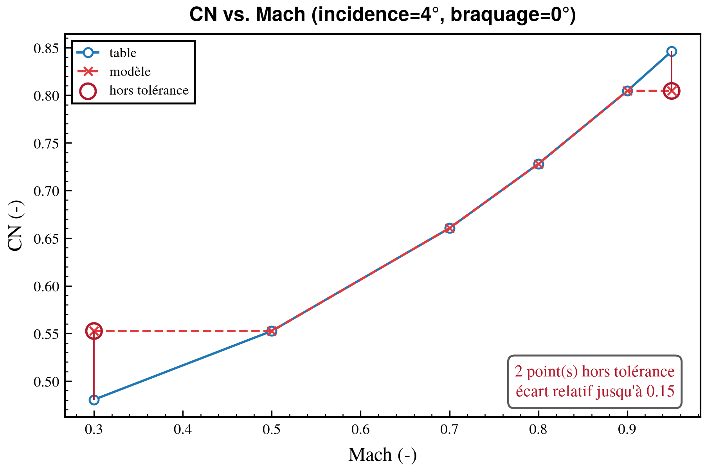
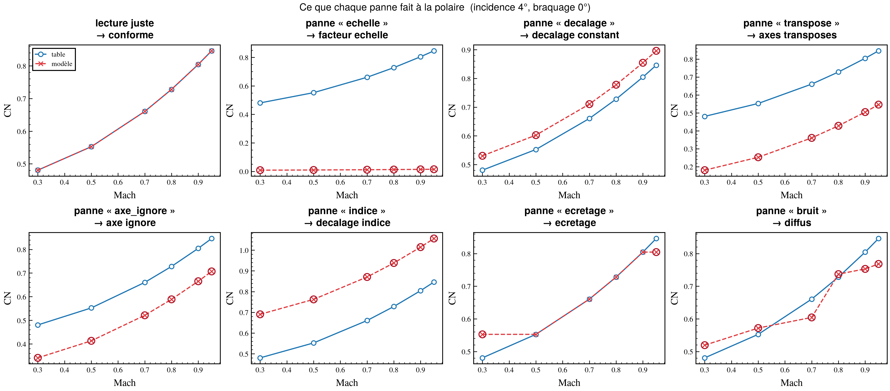

# cfd-validation

Valider un code Fortran/C depuis Python : l'envelopper, écrire des contrôles,
les exécuter, en sortir un rapport.

Le premier contrôle livré répond à une question précise — **mon modèle
relit-il correctement ses propres tables ?** — et sait dire *pourquoi* quand la
réponse est non.



*Cette figure n'est pas une illustration reconstituée : c'est une sortie de
`cfd_plot.batch_plot` telle que `tracer_rapport` l'écrit, sur un code dont
l'indice de Mach sature aux bords. Le rapport terminal qui l'accompagne dit
`ecretage — 100 % des points fautifs`.*

---

## Sommaire

* [1. Ce que ça fait](#1-ce-que-ça-fait)
* [2. Installation](#2-installation)
* [3. Prise en main](#3-prise-en-main)
* [4. Les entrées](#4-les-entrées)
    * [Le dictionnaire `TABLES`](#le-dictionnaire-tables)
    * [Votre fonction `modele`](#votre-fonction-modele)
    * [Le module enveloppé](#le-module-enveloppé)
* [5. Le rapport](#5-le-rapport)
* [6. Les planches](#6-les-planches)
* [7. La ligne de commande](#7-la-ligne-de-commande)
* [8. Plusieurs contrôles : la suite](#8-plusieurs-contrôles--la-suite)
* [9. Compiler du Fortran](#9-compiler-du-fortran)
* [10. Documentation](#10-documentation)
* [11. Développement](#11-développement)
* [12. Dépannage](#12-dépannage)

---

## 1. Ce que ça fait

Une table interpolée vaut **exactement** la valeur tabulée à chacun de ses
nœuds. Évaluer le modèle sur les nœuds de sa propre table et retrouver autre
chose signifie donc, sans discussion possible, qu'il ne lit pas la table qu'on
croit.

C'est le contrôle le plus rentable qu'on puisse écrire sur un code à tables : il
ne demande aucune référence extérieure — la table *est* la référence — et il
attrape des pannes qu'une courbe ne montre pas, parce qu'une courbe fausse est
lisse elle aussi.



Pour chaque table déclarée, le paquet :

1. **lit** le tableau dans son COMMON block, par f2py ;
2. en **retire** les grandeurs contrôlées et compose les entrées du modèle ;
3. **appelle** votre fonction et vérifie qu'elle a tenu son contrat ;
4. **compare** point à point, à la tolérance déclarée ;
5. **nomme le motif** de la panne : axes transposés, indice décalé, facteur
   d'unité, axe ignoré, indice saturé au bord, queue de tableau jamais
   renseignée ;
6. **trace**, avec `cfd_plot.batch_plot`, la table et le modèle superposés sur
   une polaire par variable indépendante, points fautifs en rouge.

Et il fait tout cela **sans compilateur** quand il le faut : le seul contrat
exigé du module est un accès par attribut `module.<bloc>.<tableau>`, qu'un
objet Python quelconque peut imiter. Le faux modèle livré
(`cfd_validation.wrap.factice`) sait reproduire chaque panne à volonté — chaque
détecteur a un cas de référence, pas un raisonnement.

---

## 2. Installation

```bash
cd tools/cfd-validation
python3 -m venv .venv && . .venv/bin/activate
pip install -e ".[dev]"
pip install -e ../cfd-plot          # pour les planches
```

Python ≥ 3.9 ; dépendances `numpy`, `pandas`, `rich`, `pyyaml`.

**`cfd-plot` n'est pas déclaré comme dépendance** : c'est un paquet frère de ce
dépôt, pas une publication PyPI. Le contrôle — lecture, comparaison,
diagnostic, rapport — tourne sans lui ; les planches, non.

**Pour compiler du Fortran**, il faut en plus `gfortran` et le moteur de
compilation de f2py :

```bash
pip install -e ".[build]"           # meson + ninja, pour NumPy >= 2
cfd-validation toolchain            # dit ce qui manque, et quoi taper
```

> **Calculateur isolé.** Le contrôle ne dépend que des quatre roues ci-dessus
> et se teste sans compilateur. Pour *compiler* sur site, prévoyez `meson` et
> `ninja` dans le cache de roues hors-ligne, et `gfortran` en paquet système.
> Sinon, compilez ailleurs sur une machine de même ABI et déposez le `.so` :
> `charger_module` l'importe par chemin. Voir
> [`00_DOC/05_ENVELOPPER_DU_FORTRAN.md`](00_DOC/05_ENVELOPPER_DU_FORTRAN.md).

---

## 3. Prise en main

### Sans code à soi

```bash
cfd-validation exemple ESSAI
bash ESSAI/RUN_EXEMPLE.sh
```

Déroule tout : lecture des tables, contrôle d'un modèle juste, rejeu des huit
pannes avec leur diagnostic, planches, et — si la machine le permet — le même
contrôle sur du Fortran réellement compilé.

### En cinq lignes

```python
from cfd_validation import valider_tables, imprimer_rapport
import aero  # votre module f2py
import mon_modele  # votre fonction, voir §4

rapport = valider_tables(aero, TABLES, modele=mon_modele.appeler)
raise SystemExit(imprimer_rapport(rapport))  # 0 conforme, 2 des écarts
```

```
╭─ Relecture de tables ─────────────────────────────────╮
│ verdict     : des écarts subsistent                   │
│ tables      : 2                                       │
│ nœuds       : 336                                     │
│ hors tol.   : 112                                     │
╰───────────────────────────────────────────────────────╯
                  Contrôle table par table
┏━━━━━━━┳━━━━━━━━━━┳━━━━━━━┳━━━━━━━━━━━┳━━━━━━━━━━━━━━━━━┓
┃ table ┃ grandeur ┃ nœuds ┃ hors tol. ┃ motif / verdict ┃
┡━━━━━━━╇━━━━━━━━━━╇━━━━━━━╇━━━━━━━━━━━╇━━━━━━━━━━━━━━━━━┩
│ CN    │ CN       │   294 │        98 │ ecretage        │
│ CA    │ CA       │    42 │        14 │ ecretage        │
└───────┴──────────┴───────┴───────────┴─────────────────┘
              Diagnostic — table « CN »
┏━━━━━━━━━━┳━━━━━━━━━━━━━━━━━┳━━━━━━━━━━┳━━━━━━━━━━━━━━━━━━━━━━━━━━━━┓
┃ grandeur ┃ motif           ┃ explique ┃ ce que cela veut dire      ┃
┡━━━━━━━━━━╇━━━━━━━━━━━━━━━━━╇━━━━━━━━━━╇━━━━━━━━━━━━━━━━━━━━━━━━━━━━┩
│ CN       │ ecretage        │     100% │ Tous les points fautifs    │
│          │                 │          │ sont aux bornes de « mach »│
│          │                 │          │ … l'indice est saturé au   │
│          │                 │          │ bord.                      │
│          │ decalage indice │      50% │ …                          │
└──────────┴─────────────────┴──────────┴────────────────────────────┘
```

### Codes de retour

| code | sens |
|:--|:--|
| `0` | tout est conforme |
| `1` | erreur d'entrée : déclaration, module, modèle |
| `2` | la commande a abouti, mais des points sont hors tolérance |

`2` et non `1` : c'est le *résultat* qui exige une action, pas la commande qui a
échoué. Un script d'intégration continue peut distinguer les deux.

---

## 4. Les entrées

### Le dictionnaire `TABLES`

Une entrée par table : **où** elle est, et **comment** la lire.

```python
TABLES = {
    "CN": {
        "bloc": "tab_cn",  # COMMON block, tel que f2py l'expose
        "tableau": "tab_cn",  # défaut : le nom du bloc
        "colonnes": ["mach", "alpha", "delta", "CN"],  # dans l'ordre du tableau
        "qoi": ["CN"],  # défaut : la dernière colonne
        "lignes": "npt_cn",  # lignes réellement renseignées
        "constantes": {"altitude": 0.0},  # ce que le modèle veut en plus
        "rtol": 1e-9,
        "atol": 1e-12,
    },
}
```

Le tableau est **long** : une ligne par point, une colonne par variable, les
valeurs tabulées en dernier — `TAB_CN(320, 4)` pour quatre colonnes.

Trois clés méritent une phrase :

* **`lignes`** — un tableau Fortran est dimensionné au maximum et un `NPTS`
  dit combien de lignes sont écrites. Sans cette clé, on compare le modèle à
  des lignes de remplissage, et le contrôle sort rouge sur un code juste. Le
  détecteur `queue_non_renseignee` rattrape l'oubli et nomme le remède.
* **`constantes`** — les colonnes que votre modèle réclame mais que cette
  table-ci ne balaie pas. Elles complètent le cadre d'entrée, sans plus.
* **les clés inconnues sont refusées**, en listant les clés admises. `rtl: 1e-3`
  laisserait sinon la tolérance par défaut, en silence.

Même structure en YAML, pour la ligne de commande. Le détail clé par clé est
dans [`00_DOC/02_DECLARER_SES_TABLES.md`](00_DOC/02_DECLARER_SES_TABLES.md).

### Votre fonction `modele`

La seule pièce que le paquet ne peut pas fournir.

```python
def appeler(entrees: pd.DataFrame) -> pd.DataFrame:
    rendu = entrees.copy()
    rendu["CN"] = aero.eval_cn(
        entrees["mach"].to_numpy(), entrees["alpha"].to_numpy(), entrees["delta"].to_numpy()
    )
    return rendu
```

Elle **reçoit** les colonnes indépendantes de la table plus les constantes —
**jamais les QOI**, sans quoi le contrôle ne prouverait rien. Elle **rend** un
cadre de même longueur, dans le même ordre, portant les QOI. Elle ne trie rien.

Un modèle qui réordonne ses lignes est **refusé**, pas rapporté comme un écart :
comparer chaque point à son voisin accuserait un modèle juste. Le contrat
complet est dans [`00_DOC/03_BRANCHER_SON_MODELE.md`](00_DOC/03_BRANCHER_SON_MODELE.md).

### Le module enveloppé

N'importe quel objet portant `module.<bloc>.<tableau>` en `ndarray`. C'est ce
que f2py produit pour un COMMON block :

```python
>>> aero.tab_cn.tab_cn.shape
(320, 4)
>>> aero.tab_cn.npt_cn
array(294, dtype=int32)
```

f2py met les noms en minuscules ; la résolution ne tient pas compte de la casse.
Un nom faux liste ce que le module expose réellement — c'est aussi ce que donne
`cfd-validation inspecter`.

---

## 5. Le rapport

`imprimer_rapport(rapport)` imprime et rend le code de retour. Pour composer
soi-même :

```python
from cfd_validation.report.console import rapport_tables, tableau_tables, tableau_motifs

console.print(rapport_tables(rapport))  # tout
console.print(tableau_tables(rapport))  # le récapitulatif seul
console.print(tableau_motifs(rapport["CN"]))  # le diagnostic d'une table
```

Les fonctions **rendent** un objet Rich plutôt que d'imprimer : l'appelant
choisit sa console.

Le rapport n'emploie pas le gras — beaucoup de terminaux le rendent en plus
clair, donc délavé sur fond clair, et c'est précisément le verdict qui
disparaîtrait. `CFD_VALIDATION_GRAS=1` le rétablit.

### Les huit motifs

| motif | ce qu'il attrape |
|:--|:--|
| `queue_non_renseignee` | les fautifs sont exactement la fin du tableau → `lignes` manque |
| `ecretage` | décalage confiné aux bornes d'un axe → indice saturé |
| `axes_transposes` | la valeur du nœud aux deux axes échangés |
| `axe_ignore` | la valeur ne bouge pas quand un axe seul bouge |
| `decalage_indice` | la valeur du nœud voisin → le sempiternel ±1 |
| `facteur_echelle` | `obtenu ≈ k·référence`, et `k` nommé s'il est connu (π/180, 0.3048…) |
| `decalage_constant` | `obtenu ≈ référence + c` |
| `diffus` | aucun motif : les pires points et leur position |

**Tous ceux qui se déclenchent sont rapportés**, classés par la part des points
fautifs qu'ils expliquent — un « premier trouvé » masquerait un défaut
composite. Comment chacun est détecté, et comment en ajouter un :
[`00_DOC/04_DIAGNOSTICS.md`](00_DOC/04_DIAGNOSTICS.md).

### Lire le résultat en Python

```python
rapport.conforme  # bool
rapport.n_points, rapport.n_fautifs
resultat = rapport["CN"]  # une table
grandeur = resultat.grandeur("CN")  # une QOI
grandeur.ecart.indices_fautifs  # les lignes du tableau Fortran
grandeur.motif_principal.nom  # "ecretage"
grandeur.motifs  # tous, du plus explicatif au moins
resultat.cadre_table, resultat.cadre_modele  # prêts pour batch_plot
```

---

## 6. Les planches

```python
from cfd_validation.report.figures import tracer_rapport

ecrits = tracer_rapport(rapport, sortie="FIGURE", formats=("png",))
```

Un appel de `cfd_plot.batch_plot` par table. Deux configurations, `TABLE` et
`MODELE`, superposées sur les mêmes axes ; une polaire par variable
indépendante, les autres devenant des niveaux de répertoire :

```
FIGURE/CN/MACH_POLAR/ALPHA_4/DELTA_0/CN_vs_mach.png
FIGURE/CN/ALPHA_POLAR/MACH_0.8/DELTA_0/CN_vs_alpha.png
…
```

Les points hors tolérance sont entourés de rouge et reliés à leur valeur
tabulée, avec un encadré qui dit combien il y en a. C'est ce qui rend la panne
*visible* : une courbe fausse, seule, reste lisse.

Deux réglages :

* **`max_valeurs=5`** — une table 20×15×7 donnerait deux mille planches. Les
  variables *épinglées* sont échantillonnées sur cinq valeurs, bornes comprises
  ; l'abscisse montre toujours tous ses points. `None` pour tout tracer.
* **`seulement_fautives=True`** — ne tracer que les tables qui ont des écarts.

Et les trois arguments de `batch_plot`, transposés : `verbeux`, `compte_rendu`,
`a_blanc` — ce dernier énumère les fichiers sans rien écrire, et un test
vérifie qu'il annonce exactement ce qu'un vrai tracé écrirait.

Pour reprendre la main, `dictionnaires(resultat)` rend les quatre dictionnaires
que `batch_plot` attend, à amender avant d'appeler `batch_plot` soi-même. Le
marquage des fautifs est un `on_before_save` ordinaire, `HookEcarts` — une
dataclass gelée de niveau module, donc **picklable**, sans quoi `batch_plot`
retomberait en silence sur un seul cœur.

---

## 7. La ligne de commande

```
cfd-validation toolchain                        de quoi f2py dispose ici
cfd-validation construire SOURCE.f [-m NOM]     compiler en module Python
cfd-validation inspecter --module M             les COMMON blocks exposés
cfd-validation check --tables T.yaml            la déclaration, sans rien exécuter
cfd-validation valider --tables T.yaml --module M --modele mod:fonction [--figures DIR]
cfd-validation exemple DEST                     recopier l'exemple
```

`--module` accepte un nom importable ou le chemin d'un `.so`. `--modele` désigne
l'objet `module:attribut`. `--figures` prend `--formats`, `--max-valeurs` (`0`
pour toutes), `--seulement-fautives`, `--verbeux`, `--a-blanc`, `--n-jobs`.

Une erreur d'entrée sort en panneau rouge nommant le fichier et le remède,
jamais en trace d'appels. `python -m cfd_validation` est l'équivalent strict,
pour les installations où le script console n'est pas utilisable.

---

## 8. Plusieurs contrôles : la suite

La relecture de tables est le premier contrôle. Le paquet est bâti pour qu'il y
en ait d'autres, et que le rapport reste un seul rapport :

```python
from cfd_validation import Suite, ControleTables
from cfd_validation.report.console import tableau_verdicts

suite = Suite([ControleTables(aero, specs, modele=appeler)])
rapport = suite.executer()
console.print(tableau_verdicts(rapport))
raise SystemExit(rapport.code_retour())
```

Un contrôle est un objet à `nom` et `executer() -> tuple[Verdict, ...]`. La
suite ne sait rien d'autre de lui.

---

## 9. Compiler du Fortran

```bash
cfd-validation construire MODELE_FORTRAN/aero.f -m aero -o build/
```

```python
from cfd_validation import construire, charger_module

aero = charger_module(construire("aero.f", nom_module="aero", destination="build"))
aero.init_tables()
```

`charger_module` importe **par chemin**, hors `sys.path` : deux compilations
d'un même modèle vivent côte à côte, ce qui est le cas d'une comparaison
avant/après correctif.

`f2py -c` a changé de moteur — `numpy.distutils` jusqu'à NumPy 1.26, **meson**
depuis NumPy 2 — et aucun des deux n'est une dépendance de NumPy. `construire`
**refuse de tenter** quand il manque quelque chose, parce que ce que produit
f2py sans meson est une trace qui ne nomme jamais le remède. Il reconnaît aussi
le piège des outils installés dans un venv non activé :

```
meson, ninja sont installés dans /…/.venv/bin mais absent(s) du PATH —
activez l'environnement virtuel, ou export PATH="/…/.venv/bin:$PATH"
```

Le source doit être en **ASCII** : f2py échoue sur le premier octet accentué.
Tout cela dans [`00_DOC/05_ENVELOPPER_DU_FORTRAN.md`](00_DOC/05_ENVELOPPER_DU_FORTRAN.md).

---

## 10. Documentation

| | |
|:--|:--|
| [`00_DOC/01_PRINCIPE.md`](00_DOC/01_PRINCIPE.md) | pourquoi relire une table valide un code, et ce que ça n'attrape pas |
| [`00_DOC/02_DECLARER_SES_TABLES.md`](00_DOC/02_DECLARER_SES_TABLES.md) | le dictionnaire `TABLES`, clé par clé |
| [`00_DOC/03_BRANCHER_SON_MODELE.md`](00_DOC/03_BRANCHER_SON_MODELE.md) | le contrat de votre fonction, et ses refus |
| [`00_DOC/04_DIAGNOSTICS.md`](00_DOC/04_DIAGNOSTICS.md) | les huit motifs, comment ils sont détectés, comment en ajouter |
| [`00_DOC/05_ENVELOPPER_DU_FORTRAN.md`](00_DOC/05_ENVELOPPER_DU_FORTRAN.md) | f2py, COMMON blocks, moteurs de compilation, calculateur isolé |
| [`src/cfd_validation/01_EXEMPLE/`](src/cfd_validation/01_EXEMPLE/) | l'exemple prêt à tourner, cinq scripts et un Fortran |

Les figures se régénèrent avec `python3 00_DOC/generer_figures.py`.

---

## 11. Développement

### Architecture

```
cli/      →  report, engine, wrap, data, core   argparse, codes de retour     FR
report/   →          engine, wrap, data, core   Rich et cfd-plot              FR
engine/   →                wrap, data, core     contrôles, suite              EN
wrap/     →                      data, core     f2py, COMMON blocks, factice  EN
data/     →                            core     specs, cadres de données      EN
core/     →  numpy seulement                    comparaison, motifs           EN
```

La règle de couche n'est pas décorative : c'est elle qui garantit que `core`
reste du calcul pur sur tableaux — seule raison pour laquelle les détecteurs se
testent sur de petites grilles écrites à la main — et que rien ne décide dans la
couche qui affiche. `tests/test_architecture.py` la vérifie par analyse d'arbre
syntaxique.

```
src/cfd_validation/
├── core/     ecart.py  motifs.py
├── data/     spec.py  entrees.py
├── wrap/     bloc.py  toolchain.py  construire.py  f2py_module.py  factice.py
├── engine/   controle.py  tables.py  diagnostic.py  suite.py
├── report/   theme.py  console.py  parcours.py  figures.py  _plotting_lib.py
├── cli/      main.py
└── 01_EXEMPLE/   (donnée de paquet, recopiée par `cfd-validation exemple`)
```

### Tests

```bash
pytest -q                          # 405 tests, ~50 s, dont 9 qui compilent du Fortran
pytest -q -m "not compilateur"     # explicitement, sur site isolé
ruff check . && ruff format --check .
mypy src/ tests/                   # strict
```

Les tests marqués `compilateur` se sautent d'eux-mêmes quand la chaîne est
incomplète, et le test qui reste dit pourquoi.

Les invariants centraux ont chacun un test nommé :

| invariant | où |
|:--|:--|
| un modèle qui relit exactement sort **zéro** point fautif, même à `rtol = 0` | `engine/test_tables.py::TestModeleJuste` |
| chaque panne injectée fait sortir **son** motif en tête | `engine/test_tables.py::TestPannes`, `core/test_motifs.py` |
| du bruit ne déclenche **que** le motif descriptif | `core/test_motifs.py::TestChaquePanneNommeSonMotif` |
| le modèle ne reçoit **jamais** une QOI | `engine/test_tables.py::TestContratDuModele` |
| table et modèle partagent leurs abscisses **au bit près** | `data/test_entrees.py::TestCadres` |
| le hook de figure est **picklable** | `report/test_figures.py::TestHook` |
| `a_blanc=True` annonce exactement ce qu'un vrai tracé écrit | `report/test_figures.py::TestTrace` |
| `construire` sans meson échoue en **nommant le remède** | `wrap/test_construire.py` |
| un COMMON block f2py est **appelable** et reste détecté | `wrap/test_bloc.py`, `test_fortran.py` |
| aucune couche ne reconnaît une colonne **à son nom** | `test_genericite.py` |
| la matrice d'import des couches | `test_architecture.py` |
| l'exemple tourne, et dit ce qu'il prétend | `test_exemple.py` |

### Conventions

- `from __future__ import annotations` en tête de chaque module ;
- dataclasses gelées, validation dans `__post_init__`, pas de pydantic ;
- erreurs métier héritant de `ValueError` et nommant la table fautive ;
- pandas confiné à `data/`, `wrap/`, `engine/` et `report/` — jamais `core/` ;
- `cfd_plot` atteint uniquement par `report/_plotting_lib.py` ;
- l'exemple n'appelle jamais le script console, dont le shebang gravé par pip
  casse en Apptainer ou dans un venv déplacé : `RUN_EXEMPLE.sh` passe par
  `${CFD_VALIDATION_PYTHON:-python3} -m`.

---

## 12. Dépannage

**« COMMON block « … » introuvable. Exposé(s) : […] »** — le nom est faux, ou
le module n'a pas été compilé avec ce bloc. La liste dit ce qu'il y a. f2py met
tout en minuscules.

**« est carré (N×N) et porte autant de colonnes que déclaré »** — l'orientation
ne peut pas s'inférer. Déclarez `orientation: lignes` ou `colonnes`.

**Motif `queue_non_renseignee`** — la clé `lignes` manque, ou pointe sur le
mauvais compteur. Les points fautifs sont exactement la fin du tableau.

**« le modèle doit rendre ses lignes dans l'ordre reçu »** — un tri ou un
`groupby` dans la chaîne d'appel. Ce n'est pas un écart, c'est un refus : le
contrôle ne peut pas conclure.

**« clé(s) inconnue(s) »** — une faute de frappe dans la déclaration. Volontaire
: une clé ignorée en silence ferait passer une table fausse pour bonne.

**`FileNotFoundError: 'meson'`** — l'environnement virtuel n'est pas activé.
`cfd-validation toolchain` le dit, avec le `export PATH` à taper.

**« 'ascii' codec can't decode »** à la compilation — un accent dans le source
Fortran. f2py lit en ASCII.

**Les planches ne sortent pas** — `pip install -e ../cfd-plot`. Le contrôle
tourne sans, le tracé non.
